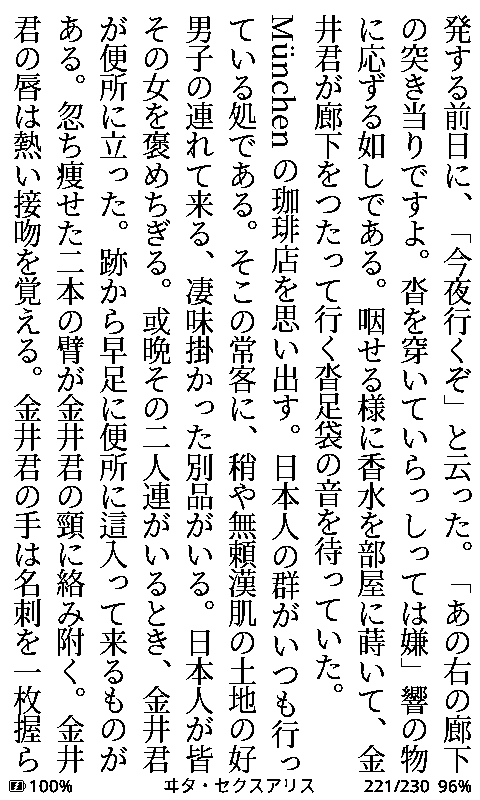
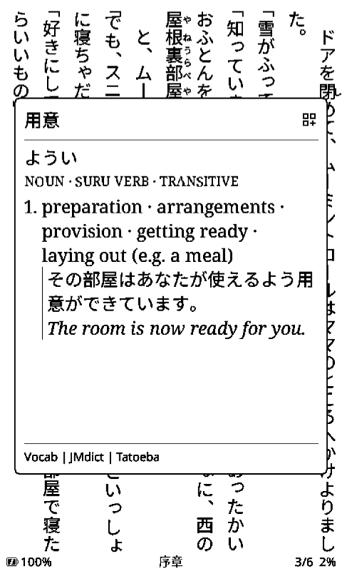
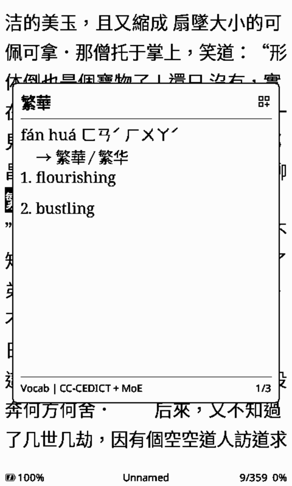
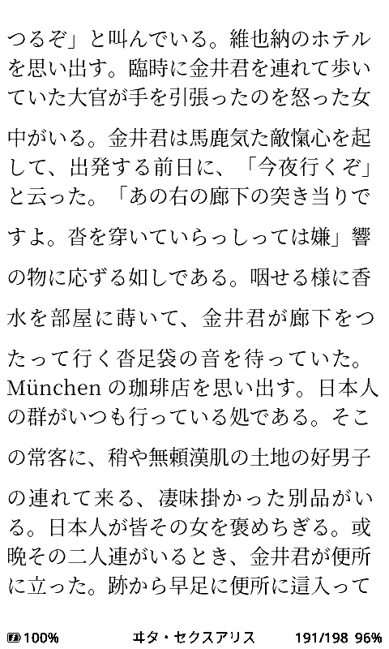
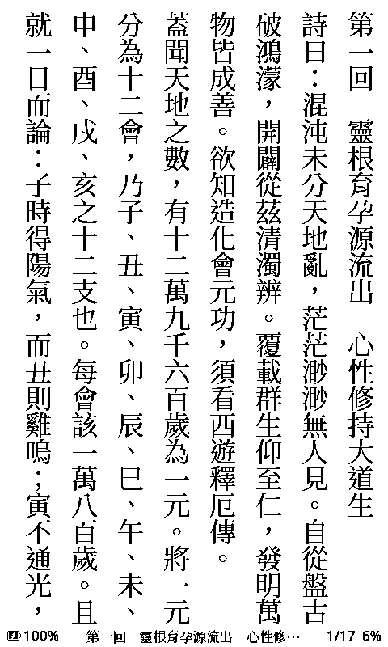
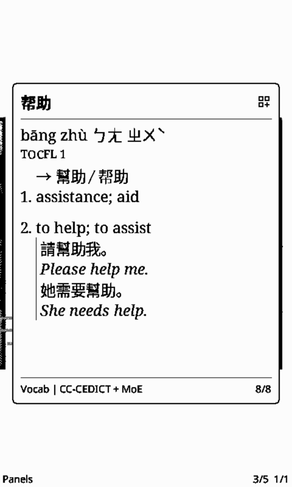
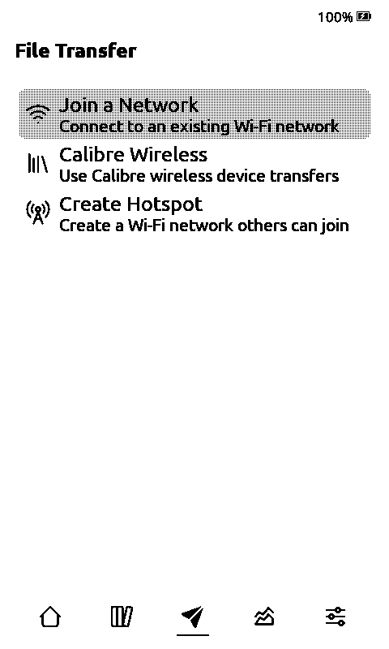
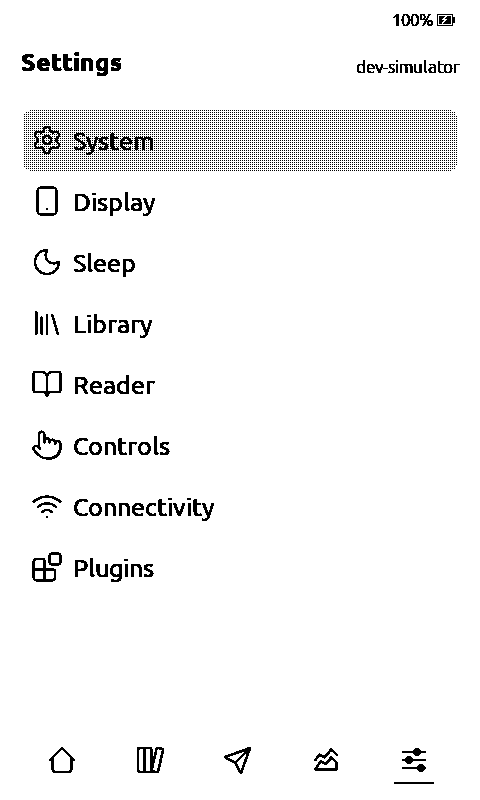

# Matcha Reader, a Japanese & Chinese reading fork of CrossPoint

Matcha Reader is a fork of [CrossPoint](https://github.com/crosspoint-reader/crosspoint-reader) e-reader firmware designed for reading books and manga in the languages you’re learning or simply love to read. It focuses on **Japanese** and **Chinese** (Simplified and Traditional, for both Mandarin and Cantonese), while offering readers of French, English, and other languages the same tools for dictionary lookups, sentence mining, and translation.

It includes everything in upstream CrossPoint. You can try it in the [simulator](https://github.com/eszter007/crosspoint-simulator-ios) first, on a desktop or an iPhone, with no device.

<p align="center">
  
  
  
  
</p>

**Runs on:** Xteink X4, X3, X4 Pro and X4 Classic, Seeed reTerminal Sticky, M5PaperMono, Metalio 3.97", EEGO A4 (both variants), BOOX Picco.

This page is the short version. How to use everything is in the [User Guide](USER_GUIDE.md).

## Reading, learning, or both

**Just reading:** flash it and copy your books. You get everything from CrossPoint, plus a cover grid library, reading insights, manga, vertical Japanese text and new sleep screens. Only Chinese needs a font on the card.

**Learning:** add a dictionary and you can look up any word on the page, save it for Anki or translate the page. Japanese and Chinese have the most support. Other languages work with any StarDict dictionary.

## Word lookup, sentence mining and page translation

Look up any word on the page, in vertical or horizontal text. In Japanese and Chinese the page is split into words first. The cursor only lands on words that have an entry. The definition opens in a panel over the page. On touch devices, long-press a word to open it. See [Guide §6.1](USER_GUIDE.md#61-word-lookup).

<p align="center">
  
  
  
</p>

**Sentence mining.** Save a word with its sentence to a CSV per language that Anki imports as is. See [Guide §6.1](USER_GUIDE.md#sentence-mining).

**Page translation.** Translates the page to English with Gemini, in the same panel. Needs Wi-Fi and your own API key. See [Guide §6.2](USER_GUIDE.md#62-page-translation).

<p align="center"></p>

Install a dictionary and that language's books get word lookup:

| | Japanese | Mandarin, simplified | Mandarin, traditional | Cantonese | Other languages |
| --- | --- | --- | --- | --- | --- |
| Word lookup | Page split into words, conjugations undone | Page split into words | Same | Same | Word by word, with word-form rules |
| Reading shown | Kana | Pinyin, HSK level | Pinyin, zhuyin, TOCFL level | Pinyin, jyutping | none |
| Dictionary | Jitendex / JMdict, names, grammar | CC-CEDICT | CC-CEDICT + MoE 重編國語辭典 | CC-Canto + CC-CEDICT | Any StarDict |
| Text layout | Vertical for right-to-left books | Horizontal | Vertical for right-to-left books | As traditional | Horizontal |
| Readings above the text | Furigana | Pinyin | Pinyin or zhuyin | none | none |
| Font | Built in | SD font required | SD font required | SD font required | Built in |

Comics, sentence mining and page translation work in every column.

## Japanese

Vertical text is detected from the book, with right-to-left columns, kinsoku, emphasis marks and furigana. Layout and furigana can be switched per book or for all books. A Japanese font is built in, and an SD font looks better and adds rare kanji. Books without furigana can get it from a script that edits the EPUB.

<p align="center">
  
  
</p>
<p align="center"><em>The same passage, Vertical Text on and off</em></p>

### Learning Japanese

With the Japanese dictionaries installed:

Conjugated words resolve to their dictionary form: 食べませんでした finds 食べる. A name the book gives furigana for is picked whole. Vocabulary, names and grammar each come from their own dictionary (Jitendex and JMdict).

See [Guide §6.3](USER_GUIDE.md#63-japanese-books).

## Chinese: Mandarin and Cantonese

Simplified books open horizontally. Traditional books open vertically when they are written right to left. An SD font is required. The built-in glyphs are the Japanese set. A wrong language tag is recognised from the text, or fixed by hand with Book Language. A script can add pinyin or zhuyin above the text of an EPUB.

<p align="center"></p>

| Simplified | Traditional | Traditional, vertical | Cantonese |
|:---:|:---:|:---:|:---:|
|  |  |  |  |
| 西游记 | 紅樓夢 | 西遊記 | 落雨天 |

### Learning Chinese

With a Chinese dictionary installed:

Words are split by frequency rather than longest match: 结婚的和尚未结婚的 reads 和 + 尚未, not 和尚. Simplified books show pinyin and the HSK level. Traditional books add zhuyin, the TOCFL level and a monolingual MoE entry. Cantonese has its own dictionary and shows jyutping. One dictionary serves both scripts and shows the other form of each word, 說 next to 说.

See [Guide §6.4](USER_GUIDE.md#64-chinese-books).

## French, English and other languages

Any StarDict dictionary works, picked by the book's language. A missed lookup is retried with word-form rules, most complete for French, where `parlaient` finds `parler`. See [Guide §6.5](USER_GUIDE.md#65-books-in-other-languages).

## In every book

### Manga, manhua and comics

Read panel by panel, each scaled to the screen, and look up words in the speech bubbles offline. Convert a CBZ, ZIP or PDF in the browser with [Matcha Reader Tools](https://eszter007.github.io/matcha-reader-tools/) and copy the `.matcha` file to the card. See [Guide §6.6](USER_GUIDE.md#66-manga-manhua-and-comics).

<p align="center">
  
  
  
  
</p>
<p align="center"><em>Japanese manga</em></p>

<p align="center">
  
  
</p>
<p align="center"><em>Chinese manhua</em></p>

### Library and home

A cover grid of every book on the card, with a **Shelves** tab for folders and a tab bar for Home, Library, File Transfer, Insights and Settings. Long-press a cover for insights, Mark as Read and Delete. With the CrossPoint sync server, badges show your furthest position on any device and offer to jump there. CrossPoint's list view is still there. See [Guide §3.1](USER_GUIDE.md#31-home-screen) and [§3.4](USER_GUIDE.md#34-library-screen).

<p align="center">
  
  
  
  
  
</p>

### Reading insights

Streak, minutes this week, books finished and a calendar, split by language. Each book has its own insights, and finishing one shows a summary. The **Insights** sleep screen shows them on a split-flap board. With the CrossPoint sync server they sync across devices and come back to a reset device. See [Guide §7](USER_GUIDE.md#7-reading-insights) and [§3.7](USER_GUIDE.md#37-sleep-screen).

<p align="center">
  
  
  
  
</p>

### Transparent sleep screen

A wallpaper over the page you were reading. The book shows through. See [Guide §3.7](USER_GUIDE.md#37-sleep-screen).

<p align="center"></p>

### Also in this fork

- Clippings and highlights work in vertical text too
- Translate the selected text from the touch selection bar
- A Toolbar reader menu laid out as a dock (Settings → Reader → Reader Menu Style)
- Optimize EPUB on upload: splits single-file novels into chapters and fits images to the screen
- A Power + Up shortcut and Sync Insights & Clock on any button shortcut
- Japanese and Chinese interface
## Setup

Files go onto the SD card with a card reader or over Wi-Fi from the device's **File Transfer** screen.

**1. Flash the firmware.**

1. Download the file for your device from [this repository's latest release](https://github.com/eszter007/matcha-reader/releases/latest):

   | Device | File |
   | --- | --- |
   | X3, and X4 (old) | `x4old-x3-firmware.bin` |
   | X4C (new) | `x4c-firmware.bin` |
   | X4 Pro | `x4pro-firmware.bin` |
   | Sticky | `sticky-firmware.bin` |
   | Papermono | `papermono-firmware.bin` |
   | BOOX Picco | `picco-firmware.bin` |

2. Connect the device by USB-C and wake it.
3. Open the [CrossPoint flash tool](https://crosspointreader.com/#flash-tools), select your device, click **Custom .bin** and choose the file.

USB-locked units must be [unlocked first](https://github.com/crosspoint-reader/crosspoint-reader#usb-locked-devices-xteink-unlocker). After that, **Settings → System → Check for updates** installs new releases over Wi-Fi (the BOOX Picco is flashed over USB each time).

**2. Install a font.** Required for Chinese, optional for Japanese, not needed otherwise. Download the zip for your language from the [fonts release](https://github.com/eszter007/matcha-reader-assets/releases/tag/fonts-2.0) and copy the `fonts` folder inside it to the root of the card.

| You read | Zip | Fonts |
| --- | --- | --- |
| Japanese | `japanese-fonts.zip` | Noto Sans JP, Noto Serif JP |
| Mandarin, simplified | `chinese-fonts-simplified.zip` | Noto Sans SC, Noto Serif SC |
| Mandarin, traditional, and Cantonese | `chinese-fonts-traditional.zip` | Noto Sans TC, Noto Serif TC |

Install both Chinese zips so dictionary entries can show the other script. Other fonts can be converted with the [browser tool](https://eszter007.github.io/matcha-reader-tools/), see [docs/sd-card-fonts.md](docs/sd-card-fonts.md).

**3. Copy your books** anywhere on the card. Manga and comics are converted first (see above).

**That is all you need to read.** The next step is for word lookup.

**4. Install a dictionary** for each language you want to look words up in. The book's language picks the folder by itself.

| Language | What to do |
| --- | --- |
| Japanese | Download `japanese-dictionaries.zip` from the [dictionaries release](https://github.com/eszter007/matcha-reader-assets/releases/tag/dictionaries-2.0) and copy its `dictionaries` folder to the root of the card. It holds `dictionaries/jp/` |
| Mandarin | Download `dictionaries-zh-simplified.zip` or `dictionaries-zh-traditional.zip` from the [dictionaries release](https://github.com/eszter007/matcha-reader-assets/releases/tag/dictionaries-2.0) and copy its `dictionaries` folder to the root of the card. Install one, not both |
| Cantonese | Download `dictionaries-yue.zip` from the [dictionaries release](https://github.com/eszter007/matcha-reader-assets/releases/tag/dictionaries-2.0) and copy its `dictionaries` folder to the root of the card |
| Any other | Copy a StarDict dictionary into `dictionaries/<lang>/<name>/`, for example `dictionaries/fr/larousse/` |

Your own dictionaries convert in the [browser tool](https://eszter007.github.io/matcha-reader-tools/). Details are in [docs/dictionary-setup.md](docs/dictionary-setup.md).

**5. Optional extras.**

- **Interface language:** Settings → System → Language. Packs download over Wi-Fi. See [Guide §3.9](USER_GUIDE.md#39-language-packs-sd-card).
- **Page translation:** save a [Google AI Studio](https://aistudio.google.com/apikey) key as `/.system/gemini.key` on the card.
- **Your own logo:** a `logo.bmp` (222x316, on white) in the card's `.system` folder. See [Guide §3.7](USER_GUIDE.md#custom-logo).

## Building from source

```bash
git clone --recursive https://github.com/eszter007/matcha-reader.git
cd matcha-reader
pio run              # build
pio run -t upload    # flash
```

More, including running in the simulator: [docs/building.md](docs/building.md). Development notes are in [CLAUDE.md](CLAUDE.md).

## Compatibility with upstream

This fork tracks upstream CrossPoint and merges each release.

## Credits

Built on [CrossPoint](https://github.com/crosspoint-reader/crosspoint-reader), open-source e-reader firmware, community-built and fully hackable.

Dictionary data from [JMdict](https://www.edrdg.org/jmdict/j_jmdict.html) and [Jitendex](https://github.com/stephenmk/Jitendex), under their respective licences. The Matcha cat is all rights reserved, and not covered by the MIT License; see [assets/images/LICENSE](assets/images/LICENSE). Icons by [Tabler Icons](https://tabler.io/icons) (MIT). The end-of-book stamps (読了, 读完, 讀完, 睇完) are lettered in Noto Serif [JP](https://fonts.google.com/noto/specimen/Noto+Serif+JP), [SC](https://fonts.google.com/noto/specimen/Noto+Serif+SC), [TC](https://fonts.google.com/noto/specimen/Noto+Serif+TC) and [HK](https://fonts.google.com/noto/specimen/Noto+Serif+HK) (SIL Open Font License). The Insights sleep screen is lettered in [Barlow Condensed](https://github.com/jpt/barlow) and [Noto Sans JP](https://fonts.google.com/noto/specimen/Noto+Sans+JP) (SIL Open Font License).
