# CrossPoint User Guide

This guide covers the **CrossPoint** firmware as shipped in Matcha Reader: the buttons, the main screens and the reading features.

> [!TIP]
> Japanese and Chinese dictionaries, fonts, and manga or manhua must be converted before the device can use them.
> [**Matcha Reader Tools**](https://eszter007.github.io/matcha-reader-tools/) does all of this in your web browser
> and gives you a zip file laid out for the SD card. You do not need to install anything. Your files stay on your
> computer. The one exception is manga text recognition (OCR), which sends page panels to Google Gemini using your own API key.
> ([source](https://github.com/eszter007/matcha-reader-tools))

- [CrossPoint User Guide](#crosspoint-user-guide)
  - [1. Hardware Overview](#1-hardware-overview)
    - [Button Layout](#button-layout)
    - [Taking a Screenshot](#taking-a-screenshot)
    - [Syncing the Clock](#syncing-the-clock)
    - [Frontlight (X4 Pro and Paper Mono)](#frontlight-x4-pro-and-paper-mono)
  - [2. Power \& Startup](#2-power--startup)
    - [Power On / Off](#power-on--off)
    - [First Launch](#first-launch)
  - [3. Screens](#3-screens)
    - [3.1 Home Screen](#31-home-screen)
      - [3.1.1 Tabs and Button Navigation (Cover Grid theme)](#311-tabs-and-button-navigation-cover-grid-theme)
    - [3.2 Reading Mode](#32-reading-mode)
    - [3.3 Browse Files Screen](#33-browse-files-screen)
    - [3.4 Library Screen](#34-library-screen)
    - [3.5 File Transfer Screen](#35-file-transfer-screen)
    - [3.5.1 Calibre Wireless Transfers](#351-calibre-wireless-transfers)
      - [Installing the Plugin in Calibre](#installing-the-plugin-in-calibre)
      - [Configuring the CrossPoint Plugin in Calibre](#configuring-the-crosspoint-plugin-in-calibre)
      - [Uploading Books](#uploading-books)
      - [Removing a Book](#removing-a-book)
    - [3.6 Settings](#36-settings)
      - [3.6.1 System](#361-system)
      - [3.6.2 Display](#362-display)
      - [3.6.3 Sleep](#363-sleep)
      - [3.6.4 Library](#364-library)
      - [3.6.5 Insights](#365-insights)
      - [3.6.6 Reader](#366-reader)
      - [3.6.7 Controls](#367-controls)
      - [3.6.8 Connectivity](#368-connectivity)
      - [3.6.9 OPDS Servers (Multiple Libraries)](#369-opds-servers-multiple-libraries)
      - [3.6.10 Web Settings (Wi-Fi + OPDS)](#3610-web-settings-wi-fi--opds)
      - [3.6.11 KOReader Sync Quick Setup](#3611-koreader-sync-quick-setup)
        - [Option A: CrossPoint Sync Server (`sync.crosspointreader.com`, default)](#option-a-crosspoint-sync-server-synccrosspointreadercom-default)
        - [Option B: Legacy Public KOReader Server (`sync.koreader.rocks`)](#option-b-legacy-public-koreader-server-synckoreaderrocks)
        - [Option C: Self-Hosted Server (Docker Compose)](#option-c-self-hosted-server-docker-compose)
        - [Syncing While Reading](#syncing-while-reading)
    - [3.7 Sleep Screen](#37-sleep-screen)
      - [Cover settings](#cover-settings)
      - [Custom images](#custom-images)
      - [Transparent sleep screen](#transparent-sleep-screen)
    - [3.8 Custom Fonts (SD Card)](#38-custom-fonts-sd-card)
    - [3.9 Language Packs (SD Card)](#39-language-packs-sd-card)
  - [4. Reading Mode](#4-reading-mode)
    - [Page Turning](#page-turning)
    - [Chapter Navigation](#chapter-navigation)
    - [Auto Page Turn](#auto-page-turn)
    - [Tilt Page Turn (X3 only)](#tilt-page-turn-x3-only)
    - [Links and footnotes](#links-and-footnotes)
    - [Dictionary Lookup](#dictionary-lookup)
    - [System Navigation](#system-navigation)
    - [Supported Languages](#supported-languages)
  - [5. Reader Menu](#5-reader-menu)
      - [5.1 Chapter Selection](#51-chapter-selection)
      - [5.2 Bookmarks](#52-bookmarks)
      - [5.3 Clippings and Highlights](#53-clippings-and-highlights)
  - [6. Language Learning Features](#6-language-learning-features)
    - [6.1 Word Lookup](#61-word-lookup)
    - [6.2 Page Translation](#62-page-translation)
    - [6.3 Japanese Books](#63-japanese-books)
    - [6.4 Chinese Books](#64-chinese-books)
    - [6.5 Books in Other Languages](#65-books-in-other-languages)
    - [6.6 Manga, Manhua and Comics](#66-manga-manhua-and-comics)
    - [6.7 Dictionary Files and Language Selection](#67-dictionary-files-and-language-selection)
  - [7. Reading Insights](#7-reading-insights)
    - [7.1 Insights](#71-insights)
    - [7.2 Per-book Insights](#72-per-book-insights)
    - [7.3 What the Numbers Do Not Cover](#73-what-the-numbers-do-not-cover)
    - [7.4 Syncing Insights Between Devices](#74-syncing-insights-between-devices)
  - [8. Current Limitations & Roadmap](#8-current-limitations--roadmap)
  - [9. Troubleshooting Issues & Escaping Bootloop](#9-troubleshooting-issues--escaping-bootloop)

## 1. Hardware Overview

On the Xteink X4 the firmware uses the device's own buttons, in the same layout as the factory firmware. Other boards differ: some have fewer buttons, and touch boards such as the X4 Pro are mostly used by tapping and swiping.

### Button Layout

| Location        | Buttons                                          |
| --------------- | ------------------------------------------------ |
| **Bottom Edge** | **Back**, **Confirm**, **Left**, **Right**       |
| **Right Side**  | **Power**, **Side Up**, **Side Down**, **Reset** |

You can change what the front buttons do in **[Controls Settings](#367-controls)**.

### Taking a Screenshot

Press **Power** and **Side Down** together. The screenshot is saved in the `screenshots` folder on the SD card. A screenshot taken inside a book goes into a subfolder named after the book.

While reading, you can also press **Confirm** to open the reader menu and choose **Take screenshot**.

### Syncing the Clock

Turn on **Power + Up Syncs Clock** in **Settings → Controls → Shortcuts**. It is off by default. After that, pressing **Power** and **Side Up** together sets the clock from the internet, on any screen.

* If Wi-Fi is not connected, the network list opens first.
* When the new time appears, press **Back**. If you started in a book, you go back to the book.
* The same sync is also available as **Sync Clock Now** in **Settings → System → Clock**.

Some devices, such as the X4, have no clock chip. Their clock drifts during sleep and resets on a restart, which makes the reading insights wrong. A sync fixes it.

**Settings → System → Clock → Show in Header** shows the time at the top of menu screens, on the opposite side from the battery. Some themes have no room for it. The time updates whenever the screen redraws. On the X4 it shows the device's own time even when that time has drifted, so a wrong time there means you should sync.

### Frontlight (X4 Pro and Paper Mono)

The X4 Pro and the M5Stack Paper Mono have a built-in light. On the X4 Pro you can set brightness and warmth. On the Paper Mono you can set brightness only. You control the light from a pull-down panel, not from the Settings menu.

* **Open the panel:** Swipe down from the top edge of the screen. This works on almost every screen, including Home, Browse Files and a book. Tapping the status bar at the top also opens it.
* **Adjust the light:** Drag the **Brightness** and **Warmth** sliders. The light changes as you drag.
* **Turn the light on or off:** Tap the **Light** button in the row of quick buttons, or press **Confirm**. The same row also has buttons for **Night Mode**, a screen refresh, screen rotation and touch controls.
* **Use the buttons:** While the panel is open, **Side Up**/**Side Down**, **Left**/**Right** and the page-turn buttons change the brightness. Hold a button to keep changing it. On devices with side buttons on the edge, the upper button always makes the light brighter.
* **Close the panel:** Swipe up, tap below the panel, or press **Back**.
* **Quick on/off (X4 Pro only):** Double-click **Power**. This shortcut is **Double-Click Power for Light** in **Settings → Controls → Shortcuts** and is on by default.

> [!NOTE]
> Brightness and warmth are not in **[Display Settings](#362-display)** on purpose. The pull-down panel is the only place to change them.

If the light stays off after the device wakes from sleep, check **Restore Light on Wake** in **Settings → Sleep**. It is on by default. Turn it off if you want the light to stay off after waking until you switch it on yourself.

---

## 2. Power & Startup

### Power On / Off

**Hold the Power button for about half a second** to turn the device on or off.

To turn the device off with a short press instead, set **Short Power Button Click** to **Sleep** in **Settings → Controls → Shortcuts** (see **[Controls Settings](#367-controls)**).

To restart a frozen device, or after a firmware update, press and release **Reset**, then quickly press and hold **Power** for a few seconds.

### First Launch

The first time you turn the device on, it opens the **[Home](#31-home-screen)** screen.

> [!NOTE]
> After that, if the device went to sleep while you were reading, it reopens that book when it starts. Hold **Back** while it starts to go to Home instead.

---

## 3. Screens

### 3.1 Home Screen

Home is where you start. From here you can open:

* your most recent book, in **[Reading Mode](#4-reading-mode)**
* the **[Library](#34-library-screen)**
* **[Browse Files](#33-browse-files-screen)**
* **OPDS Browser** (online book catalogs), or **Plugins** if you have plugins installed
* **[File Transfer](#35-file-transfer-screen)**
* **Insights** (your [reading insights](#7-reading-insights))
* **[Settings](#36-settings)**

In the **Cover Grid** theme, Home shows book covers instead of a menu. The book you are reading sits in a large card at the top, and the others follow below. The first time the device sees a book, it makes the cover in the background. Until a cover is ready, you see the book's title in its place. Pressing a button pauses this work. If a cover fails, the device tries again the next time you open Home.

**Book options:** Long-press a cover on Home, in the Library or in a shelf. On a device without touch, select the cover and hold **Confirm** for one second. The menu stays open when you let go. It offers:

* **View Insights**
* **Mark as Read** and **Mark as Unread**. You only see the one that would change something, so a finished book has no **Mark as Read**.
* **Delete**. The device asks you to confirm first. Deleting also removes the book's saved reading data.

#### 3.1.1 Tabs and Button Navigation (Cover Grid theme)

In the Cover Grid theme, a row of tabs runs along the bottom of Home, Library, File Transfer, Insights and Settings. It stays in place as you move between them. The tab you are on has a filled icon.

On a touch device, tap a tab.

On a device with buttons only, the cursor moves in one loop through the whole screen: the screen's own tabs at the top (if it has any), then its list or covers, then the bottom tabs, and back to the top.

* **Up / Side Up** and **Down / Side Down** move the cursor around the loop.
* **Confirm** on a top tab moves to the next one, e.g. **Books**, **Shelves**, **OPDS** and **Files** in the Library, or the languages in Insights. After the last top tab, the cursor moves to the bottom tabs.
* **Left** and **Right** on a top tab move to the previous or next one. In the bottom tabs, they move between Home, Library, File Transfer, Insights and Settings.
* **Confirm** on a bottom tab opens that screen. **Confirm** on the tab you are already on sends the cursor back to the first top tab.
* **Back** leaves the screen. Hold **Back** to go to Home.

A grey outline shows where the cursor is, whether on a cover, a row or a tab.

### 3.2 Reading Mode

See [Reading Mode](#4-reading-mode) below.

### 3.3 Browse Files Screen

Browse Files shows the folders and files on the SD card. The name of the current folder is shown at the top (**SD Card** at the top level). Every file is listed with its extension, including files the device cannot open. In themes without file icons, folders are shown in brackets, e.g. `[folder-name]`.

Files and folders whose names start with a dot are hidden. To show them, turn on **Settings → Display → Show Hidden Files**. You need this to delete the hidden folders a Mac leaves on the card, e.g. `.Spotlight-V100` or `.Trashes`. `System Volume Information` is always hidden.

* **Move through the list:** Use **Left** or **Side Up** to move up, and **Right** or **Side Down** to move down. Hold a button to jump a page at a time.
* **Open:** Press **Confirm** to open a folder or start reading a book. A `.bmp` file opens in the image viewer. A manga folder opens as a book.
* **Go back:** Press **Back** to go up one folder. Hold **Back** to jump to the top of the card.
* **Delete or rename:** Hold **Confirm** on a file or folder for one second. A menu offers **Open**, **Delete** and **Rename**. The device asks before it deletes anything. Deleting a folder deletes everything in it.

In the **Cover Grid** theme, Browse Files is the **Files** tab of the Library, not a separate Home entry. It keeps the **Books / Shelves / OPDS / Files** tabs at the top and the tab row at the bottom. The back arrow in the header only appears inside a folder. At the top of the card, use the tabs to leave, or press **Back** to return to **Books**. All other themes keep **Browse Files** as its own entry on Home.

### 3.4 Library Screen

Matcha has two Library screens. Choose one in **Settings → Library → Library View**:

* **Matcha Covers** (the default) shows a grid of book covers. The README describes it.
* **CrossPoint List** shows a list of titles and authors. The rest of this section is about the list.

The list keeps an index of up to 4,096 books on the SD card, so you can find a book without remembering its folder. It has three tabs. An arrow next to a tab shows the sort direction.

* **Recent** shows the ten books you opened most recently first, then the rest of your books by file date.
* **Title** groups books by the first letter of the title. Titles that start with a number or a symbol go under `#`. Other alphabets, such as Hebrew, get their own groups.
* **Author** groups books by author.

On a device with buttons only:

* Use **Up/Down** or **Left/Right** to move one row. Hold to move a page at a time. In the Cover Grid theme, **Left/Right** take you to the bottom tabs instead.
* Press **Confirm** to open the selected book.
* Press **Back** to move the cursor from the list up to the tabs.
* On the tabs, press **Confirm** to go to the next tab, and hold **Confirm** to reverse the sort direction. Press **Left** (or **Up**) to open Search. Press **Down** to return to the list.
* In **Recent**, hold **Confirm** on a book for a menu with **Open**, **Delete**, **Rebuild Library Index** and an option to remove it from the recent books.
* In **Title** or **Author**, hold **Confirm** on a book to fold the list into its letter or author groups. The group you were in stays selected. Press **Confirm** to open a group, or **Back** to return to the exact book you came from.

On a touch device, tap a tab, a book or the Search icon. Tap the tab you are on to reverse its sort. Swipe to scroll. Long-press a book in **Recent** for the book menu. Long-press a book in **Title** or **Author** to fold the list into groups, then tap a group to open it. The refresh icon in the header rebuilds the index.

The device builds the index the first time you open the list. If you add or change books later, use **Settings → Library → Rebuild Library Index**. The **Use Book Metadata** setting in the same place decides whether the index uses the title and author stored inside each book.

### 3.5 File Transfer Screen

Use File Transfer to put books on the device and manage its files over Wi-Fi. When you open it, pick a mode:

* **Join a Network**: connect to your Wi-Fi.
* **Calibre Wireless**: receive books from Calibre (see [3.5.1](#351-calibre-wireless-transfers)).
* **Create Hotspot**: the device makes its own Wi-Fi network for your computer or phone to join.
* **USB Drive**: manage the SD card from your computer over a USB cable. Only boards that support it show this option, e.g. the X4 Pro and Paper Mono.

For the Wi-Fi modes, the device starts a small web server and shows an address. Open that address in a browser on your computer or phone. The [web server docs](./docs/webserver.md) explain how to connect and upload files.

* The web page lets you download files from the device, e.g. books or screenshots, without a cable.
* The web server also supports **WebDAV**, so you can open the device as a network drive in your computer's file manager.
* When you have joined a network, the screen shows Wi-Fi signal bars.

> [!TIP]
> You can also manage files from the command line with `curl`. See the [web server docs](./docs/webserver.md).

> [!TIP]
> If a book displays badly, tick **Optimize EPUB** when you upload it from the web page. This cleans up the book before it reaches the device. It changes the file, which can break progress sync for that book.

### 3.5.1 Calibre Wireless Transfers

You can send books from Calibre to the device with the CrossPoint Reader plugin for Calibre.

#### Installing the Plugin in Calibre

If you do not have the plugin yet:

1. Go to https://github.com/crosspoint-reader/calibre-plugins/releases.
2. Download the zip file of the latest crosspoint_reader plugin.
3. In Calibre, open **Preferences → Plugins → Load plugin from file** and choose the zip file.
4. Restart Calibre.

#### Configuring the CrossPoint Plugin in Calibre
1. In Calibre, open **Preferences**.
2. Choose **Plugins**.
3. Search for "crosspoint".
4. Click **Customize plugin**.
5. Set **Host** to your device's IP address. The device shows it on the Calibre Wireless screen.
6. Leave the other settings as they are.
7. Optional: to save books in a folder other than the top of the card, change **Upload path**, e.g. `/mybooks`.
8. Restart Calibre.


#### Uploading Books

1. On the device, open **File Transfer → Calibre Wireless**. If Wi-Fi is not connected, pick a network. Keep this screen open while you send.
2. In Calibre, select one or more books.
3. Right-click the selection.
4. Choose **Send to device → Send to main memory**.

The plugin connects to the device and creates a folder for each author, at the top of the card or in your upload path. It then copies each book into its author's folder.


#### Removing a Book

You cannot remove books from the device through Calibre. Delete them on the device in **[Browse Files](#33-browse-files-screen)**, or use the web page.
### 3.6 Settings

The Settings screen has eight sections: **System**, **Display**, **Sleep**, **Library**, **Insights**, **Reader**,
**Controls** and **Connectivity**. Each one opens its own list. When **Plugins** is switched on under System, a ninth entry,
**Plugins**, appears at the end and lists the installed plugins.

Settings that are simply on or off show a switch at the right of the row. Select the row to flip it. Settings with
more choices show the current value and open a list of options.

Some rows only appear on certain devices or while another setting is on. The notes below say when.

#### 3.6.1 System

- **About**: Shows the firmware version and details about your device's hardware. Useful when asking for help.

- **Clock**: Set the **Time Zone**, **Daylight Saving** and **Clock Format** (12 or 24 hour), sync the time with
  **Sync Clock Now**, and choose **Show in Header** to show the time at the top of menu screens. See
  [Syncing the Clock](#syncing-the-clock).

- **Clear Reading Cache**: Deletes the data the reader saves for each book on the SD card. Your books stay, but
  **reading progress is lost** and each book is prepared again the next time you open it.

- **Language**: The menu language. English, Japanese, Spanish, French and German are built in. The other languages
  in the list show **Download**: select one and the device downloads its language pack over Wi-Fi and switches to it; see
  [Language Packs (SD Card)](#39-language-packs-sd-card). Chinese menus also need a Chinese font on the SD card
  (see [§6.4](#64-chinese-books)), or some characters show as boxes.

- **Keyboard Layouts**: Which on-screen keyboard layouts you can switch between when typing.

- **Plugins** (off by default): Turns the plugins on your SD card on or off. Adding or updating a plugin needs no
  firmware update. See [docs/sd-plugins.md](docs/sd-plugins.md).
  To remove a plugin, open **Home → Plugins**, select it and hold **Confirm** for a second (on a touch device,
  long-press its row), then confirm. This deletes the plugin's folder from the card.

- **Check for Updates**: Looks for a new Matcha Reader release over Wi-Fi and installs the right file for your
  device, so you keep the Matcha features. Test builds (nightlies) are never offered here. You install those by
  flashing.

- **SD Card Firmware Update**: Installs firmware without a cable. Copy the firmware `.bin` file to the SD card, then
  pick it from the list.

**Check for Updates** and **SD Card Firmware Update** are missing on boards that cannot update themselves.
**Rebuild Library Index** is under **Settings → Library**. **Manage Fonts** is at the bottom of the font list in
any profile of **Settings → Reader → Text Settings**.

#### 3.6.2 Display

- **Hide Battery %**: Where to hide the battery percentage. The battery icon always stays.
  - **Never** (default): always show it.
  - **In Reader**: hide it only while reading.
  - **Always**: never show it.

- **Refresh Frequency**: How often the whole screen flashes black and white while you read. A full refresh clears the
  faint leftovers of earlier pages (ghosting). Choose every **1**, **5**, **10**, **15** (default) or **30** pages, or
  **Never**. In manga each panel step counts as a page.

- **UI Theme**: The look of the menus.
  - **Classic**: the original CrossPoint look.
  - **Lyra**: rounded elements and menu icons. Default on button devices.
  - **Lyra Extended**: Lyra with three books on the [Home Screen](#31-home-screen) instead of one.
  - **RoundedRaff**: another rounded style.
  - **Cover Grid**: Home shows a grid of covers with a tab bar along the bottom (see
    [3.1.1](#311-tabs-and-button-navigation-cover-grid-theme)). Works with buttons or touch. Default on touch devices.

- **Sunlight Fading Fix** (off by default): Fixes text fading in direct sunlight on some X4 screens. Not shown on
  touch devices, the X4 Pro or the X4 Classic.

- **Night Mode** (off by default): White text on black, on every screen.

- **Show Hidden Files** (off by default): Shows files and folders whose names start with a dot (`.`) in the file
  browser.

#### 3.6.3 Sleep

- **Sleep Screen**: What the screen shows while the device sleeps.
  - **Dark** (default): the logo, or your own `logo.bmp`, on black.
  - **Light**: the same logo on white.
  - **Custom**: your own pictures from the SD card. See [Sleep Screen](#37-sleep-screen).
  - **Cover**: the cover of the book you are reading. Experimental.
  - **Cover + Custom**: the book cover while you are reading a book, your own pictures otherwise.
  - **None**: a blank screen.
  - **Quick Resume**: the page you were reading stays on screen with a small moon icon. Waking the device takes you
    straight back to that page.
  - **Transparent**: one of your pictures drawn on top of the current screen. See [Sleep Screen](#37-sleep-screen).
  - **Insights**: your reading insights, such as hours read, your daily streak and minutes read this week.

- **Sleep Screen Cover Mode**: How a cover fits the screen on the cover sleep screens.
  - **Fit** (default): the whole cover, centred, with white borders where needed.
  - **Crop**: fills the screen and cuts off the edges. Experimental.

- **Sleep Screen Cover Filter**: How a cover is drawn on the cover sleep screens.
  - **None** (default): in shades of grey.
  - **Contrast**: pure black and white.
  - **Inverted**: black and white, swapped.

- **Quick Resume on Timeout** (off by default): When the device falls asleep by itself (see **Time to Sleep**), it
  uses the Quick Resume screen whatever **Sleep Screen** is set to. Pressing the power button still shows your chosen
  sleep screen. Choosing **Quick Resume** as the sleep screen switches this on.

- **Time to Sleep**: How long the device waits without use before it sleeps: 1 to 30 minutes (default 10), or
  **Never**.

- **Restore Light on Wake** (on by default, devices with a frontlight only): Turns the light back on after sleep. See
  [Frontlight](#frontlight-x4-pro-and-paper-mono).

#### 3.6.4 Library

- **Library View**: What the Library entry opens.
  - **Matcha Covers** (default): a grid of book covers.
  - **CrossPoint List**: a list of titles and authors; see [Library Screen](#34-library-screen).
- **Rebuild Library Index**: Scans the card again to pick up new, moved or changed books.
- **Clear Read Books from Recent List** (off by default): Removes a book from the Recent tab once you finish it.
- **Move Finished Books to Read Folder** (off by default): Moves a finished book into a `Read` folder.
- **Use Book Metadata** (on by default): Uses the title and author stored inside each book when the list is
  rebuilt. Without it, or when a book has none, the file name is used.

While **Matcha Covers** is selected, only **Library View** and **Move Finished Books to Read Folder** appear. The
other three only affect the CrossPoint List. The cover grid always shows every book it finds on the card.

#### 3.6.5 Insights

- **Show language insights** (on by default): Shows a tab per language in [Insights](#71-insights). Turn it off to see only
  the totals for all languages. Insights are still recorded per language, so turning it back on brings the tabs back.

- **Hide unknown languages** (on by default, shown while language insights are on): Hides the **Unknown** tab, which
  holds time on books that declare no language, e.g. TXT and XTC files. The CrossPoint app has no such group either.
  The time still counts in the **All** tab.

- **Insights data** (All devices by default): **All devices** shows your whole sync account in
  [Insights](#71-insights) and on the **Insights** sleep screen, as the CrossPoint app counts it: every device, the app's
  own reader and imported time. **This device** shows only what this reader recorded. See
  [Syncing Insights Between Devices](#74-syncing-insights-between-devices).

- **Sync Insights**: Joins Wi-Fi and syncs your reading insights with the CrossPoint sync server, the same as **Refresh
  Insights** in Insights. See [Syncing Insights Between Devices](#74-syncing-insights-between-devices).

#### 3.6.6 Reader

The values here are the starting point for books you have not opened yet. Once you open a book, it remembers its own
font, size, spacing, margins, alignment, style options, images and orientation. Changes you make while reading apply
to that book only.

- **Text Settings**: Opens a list of five text profiles: **Japanese**, **Traditional Chinese**, **Simplified
  Chinese**, **Korean** and **Latin & Others**. Pick one to change its options. A preview at the top
  shows sample text in that profile's script with the current settings, and the options sit below it.
  - **Font**: the reading font. **Noto Serif** is built in. Fonts you add to the SD card are listed with it, and
    **Manage Fonts** is at the bottom. The list scrolls when it does not fit on the screen.
  - **Size**: the font size. Built-in fonts and plain TTF/OTF/TTC files offer 12, 14, 16 and 18 pt. A `.cpfont`
    family offers the sizes installed for it. When **Noto Sans** on your card consists only of Chinese or Japanese
    versions, a book offers the sizes of the version it uses, e.g. `NotoSansSC` for a simplified-Chinese book.
  - **LAYOUT**:
    - **Line Spacing**: **Tight**, **Normal** (default), **Wide** or **Extra Wide**.
    - **Word spacing**: 50% to 200% of a normal space (default 100%).
    - **Character spacing**: −2 px to +2 px (default 0 px). In vertical text this is the gap between characters down
      a column, so a tighter setting fits more characters in each column.
    - **Extra Paragraph Spacing** (on by default): adds space between paragraphs. When off, paragraphs start with an
      indent instead.
    - **Paragraph Indentation**: how far the first line of a paragraph is pushed in, from **Off** to five spaces
      (default two). It replaces the book's own indent, except where the book pulls the first line out to the left.
      Vertical text is not affected.
    - **Alignment**: **Justify** (default), **Left**, **Center**, **Right**, or **Book's Style**, which follows
      the book.
    - **Screen Margin**: the space around the text, 5 to 40 pixels in steps of 5 (default 5).
    - **Use Book Margins** (on by default): keeps the extra side margins a book sets, e.g. for indented quotes and
      letters. When off, those blocks line up with the rest of the text.
  - **STYLE**:
    - **Focus Reading** (off by default): prints the start of each word in bold to guide the eye, like Bionic
      Reading.
    - **Hyphenation** (off by default): splits long words at the end of a line. With it on, Korean text may also
      break between syllables, without a hyphen. With it off, Korean breaks only at spaces.
    - **Embedded Style** (on by default): uses the book's own formatting (its CSS).
    - **Text Anti-Aliasing** (on by default): smooth grey edges on letters, furigana included. The grey appears
      about half a second after a page turns. Turning pages faster than that skips it.
  - The Japanese and Chinese profiles list only **Embedded Style** and **Text Anti-Aliasing** under **STYLE**.
  - While a book is shown vertically, **LAYOUT** lists only **Line Spacing**, **Character spacing** and
    **Screen Margin**, the settings vertical text uses.

- **Text profiles**: each of the five profiles keeps its own **font**, **font size**, **line spacing**, **character
  spacing** and **word spacing**, so a font that suits Japanese leaves your English books alone. A book uses the
  profile of its language: Japanese, traditional Chinese (Cantonese too), simplified Chinese, or Korean (a book
  tagged `ko` or `kor`). Every other book uses **Latin & Others**. Opened from inside a book, **Text Settings** goes
  straight to that book's profile. A size or spacing you change while reading goes to the book's profile too. A font
  you pick while reading stays with that book only: change a profile's font from **Settings → Reader → Text
  Settings**.

- **Dictionary Settings**: Opens a page with the word lookup settings:
  - **Word Lookup Font Size**: Text size in the word lookup window: **Tiny**, **Small** (default), **Medium** or
    **Large**.
  - **Japanese dictionary**, **Mandarin dictionary**, **Cantonese dictionary**: Read-only. They show **Installed**
    when the files for that language were found (`/dictionaries/jp/`, `zh/` or `yue/`), else **Not installed**. These
    dictionaries are used automatically in books of their language, so they are not in the fallback list.
  - **Fallback for other languages**: The StarDict dictionary for word lookups, or **None**. Lookups use a dictionary
    that matches the book's language first, then this one. Only shown when a dictionary folder exists under
    `/dictionaries/` or `/.dictionaries/` on the SD card. See [docs/dictionary.md](docs/dictionary.md).

- **Reading Orientation**:
  - **Portrait** (default)
  - **Landscape CW**: turned a quarter clockwise.
  - **Portrait 180°**: upside down.
  - **Landscape CCW**: turned a quarter counter-clockwise.

- **Tategaki (vertical Japanese)** and **Zhípái (vertical Chinese)**: Whether Japanese and Chinese books open in
  vertical columns.
  - **Automatic** (default): follows the book. A book set to read right to left opens vertically, any other book
    horizontally.
  - **On**: always vertical.
  - **Off**: always horizontal.

  The **Vertical Text** switch in a book's Reader Settings overrides this for that book.

- **Rotate Panels** (on by default): In manga, turns a panel sideways when that makes it fit the screen better.

- **Images**: Pictures inside books.
  - **Display** (default): shows them.
  - **Placeholder**: shows only the picture's description text.
  - **Suppress**: leaves them out.

- **Reader Menu Style**: How the reader menu looks: **List** (default), a full-screen list, or **Toolbar**, bars at
  the top and bottom of the page.

- **Customise Status Bar**: The line of information at the edge of the page while you read. Set it up one item at a
  time: chapter page count, book progress percentage, progress bar (book, chapter or hidden) and its thickness, title,
  battery, the status bar for XTC files, and the clock when the device knows the time.
  - **Time Left**: an estimate of the reading time left in the chapter or the book (default: hidden). It is shown before the page count, e.g. "12 min". It learns from how long you stay on each page as you turn forward, ignoring pages you skip past in under 2 seconds or leave open for more than 30 minutes. A page left open much longer than your usual pace counts as about three times your average. Each book keeps its own reading speed, measured against how much of the book's text you get through, so it stays right when you change the font size or margins. The estimate appears once about five pages have been timed.

#### 3.6.7 Controls

Which rows you see depends on your device. Touch devices hide the rows that only make sense with front buttons.

- **Shortcuts**: Opens the button shortcuts, in this order. Each one is described further down.
  - **Home Button Gestures** (devices with a Home key)
  - **Long-Press Button Behavior**
  - **Long-Press Menu** (button devices)
  - **Power + Up Syncs Clock**
  - **Double-Click Power for Light** (X4 Pro)
  - **Short Power Button Click**
  - **Tilt Page Turn** (devices with a motion sensor, e.g. the X3)
  - **Quick return from links** (only while **Short Power Button Click** is **Links and footnotes**)
  - **Upper Side Button in Reader** and **Lower Side Button in Reader**
  - **Short Back to File Browser** (button devices)

- **Remap Front Buttons** (button devices): Choose what each button below the screen does.

- **Haptic Feedback** (off by default, devices with a vibration motor only): A short buzz when the device accepts a
  touch.
  - **On Touch**: taps, long presses and touch page turns.
  - **On Touch + Page Turn**: adds the touch page-turn buttons.
  - **Off**
  - A touch that does nothing, such as a tap on the tab you are already in, stays silent.

- **Haptic Intensity**: **Low**, **Medium** or **High** (default).

- **Orient Front Buttons** (on by default, button devices): Arrow buttons follow the direction you see on screen when
  you turn the device, and their hints change to match. In landscape the front buttons move up and down and the side
  buttons move left and right. Switch it off to keep every button as it works in portrait. Touch devices always
  follow the screen.

- **Navigate with Side Buttons in Word Lookup** (off by default): The side buttons move between words during Word
  Lookup. See [Word Lookup](#61-word-lookup). It has no effect once both side buttons have their own action.

- **Reversed page turn (Vertical & Manga)** (off by default): Swaps the page-turn direction for the two kinds of
  book read right to left.
  - In a **vertical (tategaki) Japanese book**, the button that normally goes back turns forward.
  - In **manga**, the left button goes forward (through the panels, then the pages) and the right button goes back.
  - Horizontal books in any language are **not** affected.

  It changes page turning only, on buttons, taps and swipes alike. Menus and Word Lookup keep their usual
  directions. It is one setting for all books. While it applies, **Inverted Tap** and **Inverted Swipe** add
  nothing, so the two do not cancel each other out.

- **Back Resumes Last Book** (off by default; X3, X4 and X4 Classic): On the Home screen, **Back** reopens the book
  you read last, and its hint reads **Resume**.

- **Upper / Lower Side Button in Reader** (in Shortcuts): What each side button does while reading. On the X4 Pro and
  X4 Classic the rows are called **Left** and **Right Side Button in Reader**.
  - Options: **Default** (previous page on the upper button, next page on the lower), **Previous Page**,
    **Next Page**, **Sleep**, **Refresh Screen**, **Links and footnotes**, **Word Lookup**, **Create Clipping** or
    **Off**.
  - A button with its own action does only that. Outside the reader both buttons work as usual.
  - In Word Lookup, a button set to **Previous Page** or **Next Page** moves between words.
  - A button set to **Word Lookup** starts word selection on the first press, looks up the word on the second, and
    closes the definition on the third.
  - **Reversed page turn** does not change a button you set yourself. **Next Page** always goes forward.

- **Long-Press Button Behavior**: What holding a page-turn button does.
  - **Off** (default): nothing extra.
  - **Chapter Skip**: jumps to the next chapter, or back to the start of the chapter, then to the previous one.
  - **Orientation Change**: turns the screen to the next orientation.

- **Long-Press Menu** (button devices): What holding **Confirm** does while reading. A short press always opens the
  reader menu.
  - **KOSync**: hold about 1 second to start CrossPoint Sync. Works once sync is set up.
  - **Disabled** (default): holding does nothing.
  - **Bookmark**: hold about 0.4 seconds to bookmark the page.
  - **Dictionary**: hold about 0.4 seconds to pick a word to look up (see [docs/dictionary.md](docs/dictionary.md)).
  - **Create Clipping**: hold about 0.4 seconds to start selecting a clipping.
  - **Links and footnotes**: hold about 0.4 seconds to open the page's links and footnotes.

- **Power + Up Syncs Clock** (off by default): Press Power and the upper side button together to set the clock from
  the internet, on any screen. See [Syncing the Clock](#syncing-the-clock).

- **Double-Click Power for Light** (on by default, X4 Pro): Double-click Power to switch the frontlight on or off.

- **Short Power Button Click**: What a quick press of the power button does.
  - **Ignore** (default): nothing. Hold the button to switch off.
  - **Previous Page**: while reading, goes back one page.
  - **Next Page**: while reading, turns to the next page. Hold the button to switch off.
  - **Sleep**: puts the device to sleep.
  - **Refresh Screen**: a full refresh that clears ghosting.
  - **Links and footnotes**: while reading, opens the page's links and footnotes. With only one on the page, it
    jumps straight there. Press again to choose an entry, and once more to return to your page.
  - **Word Lookup**: while reading, the first press starts word selection, the second looks up the word, and the
    next closes the definition.
  - **Create Clipping**: while reading, starts selecting a clipping.
  - **Confirm** (touch devices only): works like a Confirm button.
  - **Bookmark**, **KOSync** and **Reader Menu** (touch devices without a Home key): add or remove a bookmark, start
    a sync, or open the reader menu.

- **Tilt Page Turn** (devices with a motion sensor): Tilt the device to turn pages: **Off** (default), **Normal** or
  **Inverted**.

- **Touch Reader Controls** (on by default, touch devices only): Lets touching the page turn it while reading. When
  off, taps and swipes no longer turn pages, but tapping the centre for the menu and holding a word still work. When
  on, two more rows set each direction.

  - **Next Page** and **Previous Page**: **Tap & Swipe**, **Tap Only**, **Swipe Only** (default), **Inverted Tap**,
    **Inverted Swipe** or **Disabled**.
    - Taps: the left third of the page goes back and the rest goes forward. The centre opens the menu. When only one
      direction uses taps, the whole page turns that way.
    - Swipes: swipe left to go forward and right to go back.
    - The **Inverted** choices swap these. For vertical books and manga, **Reversed page turn** does the same and
      also covers the buttons.

- **Show Reader Menu** (devices with a Home key only): How the reader menu opens: **Off**, **Tap** (default, tap the
  centre) or **Swipe Up**. With **Off** you can still open it through the Home key.

- **Tap to look up** (no setting of its own): When neither page direction uses taps, a short tap on a word looks it
  up, and holding a word starts a clipping that you drag out with your finger. Tapping a link still follows it, and
  tapping empty space in the centre opens the reader menu. In manga, holding inside a speech bubble still looks up
  the text.

- **Quick return from links** (on by default, in Shortcuts): Only shown while **Short Power Button Click** is
  **Links and footnotes**. A quick press of Power on a footnote page then takes you back, like the Back button.

- **Short Back to File Browser** (off by default, button devices): Swaps what Back does in a book. A short press
  opens the file browser and a long press goes Home, instead of the other way round.
#### 3.6.8 Connectivity

- **Wi-Fi Networks**: Save and connect to Wi-Fi networks. You need Wi-Fi for file transfers, sync, font downloads and firmware updates.

- **Bluetooth Page Turner** (only on boards built with Bluetooth): Use a Bluetooth remote to turn pages.
  1. Switch **Bluetooth Page Turner** on.
  2. Open **Scan for Remotes** and pick your remote from the list.
  3. **Paired Remotes** lists the remotes you have saved. Select a row marked **Forget** to remove that remote.

  The remote works right away with its default buttons. To choose what each button does, open **Map Buttons** (it needs a connected remote):
  1. Select an action: **Next Page**, **Previous Page**, **Next Chapter**, **Previous Chapter**, **Confirm**, **Back**, **Reader Menu** or **Create Clipping**.
  2. Press the remote button you want for it within 15 seconds.
  3. A short tap and a hold (0.7 seconds or longer) count as two different buttons, so one remote button can do two jobs. Some remotes never report that the button was let go. In that case the device waits the full 15 seconds and saves the press as a tap.

  Good to know:
  - Each button can do one thing. Mapping it again replaces the old action.
  - To clear an action, hold **Confirm** on it (or long-press the row on a touch screen).
  - **Back** cancels a mapping in progress, or returns to the Bluetooth menu.
  - While reading, remote **Confirm** and **Back** work like the device buttons. With the reader menu open, the page buttons move through the menu items instead of turning pages.
  - You can also switch Bluetooth on or off from the reader menu, or from the toolbar's **More** menu.

- **CrossPoint Sync**: Sync your reading position with the CrossPoint sync server or any KOReader-compatible sync server. See [KOReader Sync Quick Setup](#3611-koreader-sync-quick-setup) below.

- **OPDS Servers**: Save online book catalogs (OPDS libraries) so you can browse them and download books straight to the device. See [OPDS Servers (Multiple Libraries)](#369-opds-servers-multiple-libraries) below. ([What is OPDS?](https://en.wikipedia.org/wiki/Open_Publication_Distribution_System))

#### 3.6.9 OPDS Servers (Multiple Libraries)

You can save up to 8 catalogs (for example your Calibre library at home and a public catalog) and switch between them.

**Where to find your catalogs**

- **Cover Grid** theme: open the Library's **OPDS** tab (next to **Books**, **Shelves** and **Files**). It lists your saved servers and an **Add Server** row. Choose a server to open its catalog. Wi-Fi only connects at that moment, never just because you moved across the tabs. Press **Back** at the top level of a catalog to return to the tab.
- Other themes: open the catalogs from the home menu.

In the Cover Grid theme the catalog stays inside the Library screen, with the tabs above it and the bottom bar below. Only the Wi-Fi picker takes the full screen. On a device without a touch screen:
- **Up** from the first entry jumps to the tabs. There, **Left** and **Right** switch tabs.
- **Down** past the last entry jumps to the bottom bar.
- On an error screen or an empty catalog, **Up** and **Down** go straight to the tabs and the bar.

**Add or edit a server**

1. Open **Settings → Connectivity → OPDS Servers**.
2. Select **Add Server**, or select a saved server to edit it.
3. Fill in the fields:
   - **Server Name**: Any name you like, e.g. "Home Calibre". Optional.
   - **OPDS Server URL**: The full catalog address. For Calibre Content Server it usually ends in `/opds`.
   - **Username** and **Password**: Only if the server asks you to log in.
   - **Custom Header 1** and **Custom Header 2**: Only if your server's instructions tell you to set them. Most people leave these empty.
4. To remove a server, open it and select **Delete Server**.

The same **OPDS Servers** screen also has **Download folder** (where downloaded books are saved) and **Filename format** (how they are named).

> [!NOTE]
> Logins use standard "Basic" authentication. If your Calibre Content Server requires a login, set its authentication type to **Basic** (Digest does not work).

You can also manage servers from a computer or phone. See [Web Settings (Wi-Fi + OPDS)](#3610-web-settings-wi-fi--opds).

#### 3.6.10 Web Settings (Wi-Fi + OPDS)

The device's web page lets you manage saved Wi-Fi networks and OPDS servers from a browser.

1. On the device, open **File Transfer** and choose **Join a Network** or **Create Hotspot**.
2. On your computer or phone, open `http://<device-ip>/settings` (the address shown on the device screen) or `http://crosspoint.local/settings`.
3. In the **Wi-Fi Networks** card, add, edit or delete networks (network name, called SSID, plus an optional password).
4. In the **OPDS Servers** card, add, edit or delete catalogs.

Good to know:
- Saved passwords are never shown again. A password field marked **(unchanged)** already has one stored.
- To keep a stored password while editing, leave the password field empty.
- You can save a hidden network here. Whether the device can then connect to it depends on the device's own Wi-Fi connection screen.

#### 3.6.11 KOReader Sync Quick Setup

Sync keeps your reading position the same on every device that uses the same sync server and account. That includes KOReader apps on phones and other e-readers.

All settings live in **Settings → Connectivity → CrossPoint Sync**. Two of them decide what gets sent.

**Server Type** tells the device what kind of server it talks to:
- **Matcha**: The default CrossPoint sync server, or a self-hosted server that works like it. Sends the standard KOReader position plus a more precise position of its own.
- **KoSync**: Standard KOReader sync servers, e.g. `sync.koreader.rocks` or a self-hosted `koreader/kosync`. Sends only the standard KOReader data.
- **Other**: Custom servers that support the extra CrossPoint data. With **Send Document Metadata** on, it can also send the ISBN, ASIN, series name and series number.

**Send Document Metadata** controls your privacy. Turn it off to sync only your position, without the book's title, author, ISBN/ASIN or series.

Your password is typed in plain. The device turns it into the coded form (an MD5 hash) that sync servers expect.

##### Option A: CrossPoint Sync Server (`sync.crosspointreader.com`, default)

This free server is used when **Sync Server URL** is empty. KOReader apps can use it too.

On each device:
1. Go to **Settings → Connectivity → CrossPoint Sync**.
2. Enter your **Username** and **Password**. Use the same ones on every device.
3. Leave **Sync Server URL** empty, or enter `https://sync.crosspointreader.com`.
4. Set **Server Type** to **Matcha**.
5. On your first device, select **Sign Up** once to create the account. On every other device, select **Authenticate**.

Accounts belong to one server. An account on `sync.koreader.rocks` does not exist on the CrossPoint server. Sign up again (you can reuse the same username and password), or use Option B to stay on the old server.

##### Option B: Legacy Public KOReader Server (`sync.koreader.rocks`)

Use this if your KOReader devices already sync with the official public server.

1. On each device:
   1. Go to **Settings → Connectivity → CrossPoint Sync**.
   2. Set **Sync Server URL** to `https://sync.koreader.rocks`. You must enter it: an empty field means the CrossPoint server.
   3. Set **Server Type** to **KoSync**.
   4. Enter your existing KOReader sync **Username** and **Password**.
   5. Select **Authenticate**.

2. No account yet? Select **Sign Up** on the device, or create one from a computer with curl:

```bash
USERNAME="user"
PASSWORD="pass"
PASSWORD_MD5="$(printf '%s' "$PASSWORD" | openssl md5 | awk '{print $2}')"

curl -i "https://sync.koreader.rocks/users/create" \
  -H "Accept: application/vnd.koreader.v1+json" \
  -H "Content-Type: application/json" \
  --data "{\"username\":\"$USERNAME\",\"password\":\"$PASSWORD_MD5\"}"
```

An answer of `HTTP 402` with `{"code":2002,"message":"Username is already registered."}` means the name is taken. Pick another, or log in with that account if it is yours.

##### Option C: Self-Hosted Server (Docker Compose)

This runs your own KOReader sync server (`koreader/kosync`) with Docker or Podman.

1. Start the server:

```bash
mkdir -p kosync-quickstart
cd kosync-quickstart

cat > compose.yaml <<'YAML'
services:
  kosync:
    image: koreader/kosync:latest
    ports:
      - "7200:7200"
      - "17200:17200"
    volumes:
      - ./data/redis:/var/lib/redis
    environment:
      - ENABLE_USER_REGISTRATION=true
    restart: unless-stopped
YAML

# Docker
docker compose up -d

# Podman (alternative)
podman compose up -d
```

> [!NOTE]
> `ENABLE_USER_REGISTRATION=true` makes first setup easy. Once your users exist, set it to `false` (or remove it) so strangers cannot register.

2. Check that it runs:

```bash
curl -H "Accept: application/vnd.koreader.v1+json" "http://<server-ip>:17200/healthcheck"
# Expected: {"state":"OK"}
```

3. Create a user once. The server stores the MD5 hash of the password, so send the hash:

> [!WARNING]
> Over plain HTTP the MD5 hash travels unencrypted and anyone on the network can reuse it.
> Make a separate sync-only password. Never reuse an important one.
> Use `https://<server-ip>:7200` whenever traffic leaves a network you fully trust.
> Use `curl -k` only to test a self-signed certificate.

```bash
USERNAME="user"
PASSWORD="pass"
PASSWORD_MD5="$(printf '%s' "$PASSWORD" | openssl md5 | awk '{print $2}')"

curl -i "http://<server-ip>:17200/users/create" \
  -H "Accept: application/vnd.koreader.v1+json" \
  -H "Content-Type: application/json" \
  --data "{\"username\":\"$USERNAME\",\"password\":\"$PASSWORD_MD5\"}"
```

`HTTP 402` with `{"code":2002,"message":"Username is already registered."}` means the account already exists.

4. On each device:
   1. Go to **Settings → Connectivity → CrossPoint Sync**.
   2. Enter the **Username** and the plain **Password** (the device makes the hash itself). Use the same ones on every device.
   3. Set **Sync Server URL** to `http://<server-ip>:17200`, or `https://<server-ip>:7200` for the encrypted port.
   4. Set **Server Type** to **KoSync**.
   5. Select **Authenticate**.

##### Syncing While Reading

To sync, press **Confirm** while reading to open the reader menu, then select **Sync Progress**.

For a shortcut, set **Settings → Controls → Shortcuts → Long-Press Menu** to **KOSync**. Holding **Confirm** then starts a sync.

**Sync Behavior** decides what happens when the device and the server disagree:
- **Smart Sync** (default for new setups) handles the easy cases on its own. It uploads your position when the server has none or when you are further ahead. It jumps to the server's position when that one is further ahead. If both already match, it confirms and changes nothing.
- **Ask Every Time** lets you choose each time: **Apply remote progress** jumps to the server's position, **Upload local progress** sends yours. Setups saved by older firmware keep this choice until you change it.

**Sync Clippings** is off by default. Turn it on only with a CrossPoint sync server that supports clippings. **Sync Progress** then also uploads and downloads this book's clippings. Leave it off for ordinary KOSync servers.

With the CrossPoint sync server, **Sync Progress** also uploads your reading insights: minutes per day, total time, books finished and your longest streak, plus each book's reading time, sessions and finished status (as the finish date it sends the day on the end-of-book stamp, or your last reading day for books finished before that day was saved). The CrossPoint app then shows your measured reading time, overall and per book. Insights are only sent once the clock is set (see [Syncing the Clock](#syncing-the-clock)). The first sync sends up to two years of history and the insights of every book in your reading insights, so it takes longer than usual; later syncs only send the days and books read since. If the upload fails, your progress still syncs and the next sync picks up where it stopped. Your insights then live on the server too, so switching to another reader or resetting this one loses nothing: the CrossPoint app keeps showing your whole history, and **Refresh Insights** brings your daily reading time back to the device (see [Syncing Insights Between Devices](#74-syncing-insights-between-devices)). Dictionary lookups and saved sentences are not synced. Time of day and pages are not recorded on the device, so those charts in the app stay empty for it. All CrossPoint readers on one account count as one device. Ordinary KOSync servers get no insights.

### 3.7 Sleep Screen

Choose what the screen shows while the device sleeps in **Settings → Sleep → Sleep Screen**.

| Mode               | What you see                                                                                                    |
| ------------------ | --------------------------------------------------------------------------------------------------------------- |
| **Dark** (default) | The logo on a black background. See [Custom logo](#custom-logo) to use your own.                                |
| **Light**          | The logo on a white background.                                                                                 |
| **Custom**         | Your own picture from the SD card (see [Custom images](#custom-images)). Shows **Dark** if none is found.       |
| **Cover**          | The cover of the book you have open. Shows **Dark** if no book is open.                                         |
| **Cover + Custom** | The book cover when you put the device to sleep while reading. From anywhere else, behaves like **Custom**.     |
| **None**           | A blank screen.                                                                                                 |
| **Quick Resume**   | Leaves the current screen as it is, so the page you were on stays visible.                                      |
| **Transparent**    | A picture drawn on top of the current page (see [Transparent sleep screen](#transparent-sleep-screen)). Shows **Dark** if no usable picture is found. |
| **Cover + Transparent** | The transparent picture drawn on top of the cover of the last book you opened, from any screen. Behaves like **Transparent** if that book has no cover, and shows the plain cover if no usable picture is found. On the X4 the cover is drawn in dithered black and white under the picture. |
| **Insights**          | Your reading insights styled as a train departures board: total hours read, current day streak and minutes this week. The board's words are always in English and Japanese. |

#### Cover settings

Two more settings change how pictures look in **Cover**, **Cover + Custom**, **Cover + Transparent** and **Custom**:

- **Sleep Screen Cover Mode**: **Fit** shows the whole picture with white borders. **Crop** fills the screen and trims the edges.
- **Sleep Screen Cover Filter**: **None** keeps the shades of gray. **Contrast** turns the picture pure black and white. **Inverted** does the same with the colors swapped.

#### Custom images

Set **Sleep Screen** to **Custom** or **Cover + Custom**, then put BMP images on the SD card:

- **Several images (recommended):** Make a folder called `.sleep` in the top level of the SD card and put your `.bmp` files in it. The device picks one at random each time it sleeps. A folder called `sleep` works too.
- **One image:** Put a file called `sleep.bmp` in the top level of the card. It wins over the folders.

#### Transparent overlay images

Set **Sleep Screen** to **Transparent** or **Cover + Transparent**, then put BMP or PNG images on the SD card:

- **Several images (recommended):** Make a folder called `.sleep-overlay` in the top level of the card and put your `.bmp` or `.png` files in it. One is picked at random each time. Folders called `sleep-overlay` and `.sleep/transparent` work too, and pictures in all of them share one pool.
- **One image:** Put `sleep-overlay.bmp` or `sleep-overlay.png` in the top level of the card. The BMP wins over the PNG, and both win over the folders.

Keep these pictures apart from your normal sleep images, because they work differently:
- In a normal BMP, white areas let the page show through.
- For soft, see-through edges, use a PNG with transparency, or a 32-bit BMP with an alpha channel. In these files a solid white pixel covers the page.

> [!TIP]
> For the best results:
> - **Custom** mode: use uncompressed 24-bit BMP files.
> - **Transparent** mode: use a PNG or a 32-bit BMP for soft transparency, or a normal BMP where white means "see-through".
> - X4: make images 480x800 pixels, the size of the screen.
> - X3: make images 528x792 pixels.

> [!TIP]
> You can set a picture as your sleep screen straight from the image viewer in **[Browse Files](#33-browse-files-screen)**.

#### Custom logo

You can replace the cat on the start-up screen and on the **Dark**, **Light** and **Insights** sleep screens with your own drawing. No setting needed.

1. Make a BMP image called `logo.bmp`.
2. Put it in the device's system folder on the SD card. That is the folder holding `reading_stats.bin` and `bookstats`, usually the hidden `.system` folder (a folder called `system` works too).
3. To get the cat back, delete the file.

Tips for the image:
- Size: 222x316 pixels is ideal. The device adds a 4-pixel white border around it. Bigger images up to 800 pixels on each side are shrunk to fit. Smaller ones are centered and never enlarged.
- Any uncompressed BMP works (1, 2, 4, 8, 24 or 32-bit). The device shows it in 4 shades of gray, so very light grays turn white.
- Draw on a plain white background. A 32-bit BMP with transparency is placed on white.
- On the dark screens it gets a white outline, like the cat. The white around the drawing turns black, while white areas inside the drawing (a face, a book page) stay white.
- The start-up screen shows only black and white, so it can start quickly. Light gray parts vanish there, so use dark lines.
- The **Insights** screen may show the logo smaller, or leave it out if there is no room.
- Still seeing the cat? The file is probably bigger than 800 pixels on a side, compressed, or damaged. The serial log names the reason.

#### Transparent sleep screen

**Transparent** draws a picture on top of the page you were reading. White parts of the picture let the page show through and black parts paint over it. You see your artwork and the paragraph where you stopped, together.

Put 480x800 images (X4) or 528x792 images (X3) in `.sleep-overlay` on the card, as described above. Pictures with lots of white space work best, because solid areas hide the text below. Artwork along one edge, like the example, keeps most of the page readable.

<p align="center"></p>

---

### 3.8 Custom Fonts (SD Card)

You can add fonts from the SD card. Use them for a different look, or for Chinese, Japanese, Korean and other scripts that the built-in fonts do not cover.

Fonts come in `.cpfont` files, one file per size. You can convert any TTF or OTF font yourself with [Matcha Reader Tools](https://eszter007.github.io/matcha-reader-tools/) in your browser. On boards with extra memory (PSRAM), the device can also read `.ttf`, `.otf` and `.ttc` files directly, without converting them. The dictionary panel then uses that font too, for characters its own font lacks such as IPA, except in Japanese and Chinese books.

**Ways to install a font**

1. **Download on the device (easiest):** Go to **Settings → Reader → Text Settings**, pick a profile, open **Font**, scroll to the bottom of the list and select **Manage Fonts**. Pick a font family to download it over Wi-Fi.
2. **Upload from a browser:** In **File Transfer** mode, open the device's web page and use the **Fonts** tab. It takes `.cpfont` files. On boards with PSRAM it also takes `.ttf` and `.otf`.
3. **Copy to the SD card:** Put each font in its own folder inside `/.fonts/` (or `/fonts/`), named like this: `.fonts/<Family>/<Family>_<size>.cpfont`, e.g. `.fonts/NotoSansSC/NotoSansSC_16.cpfont`. Ready-made `.cpfont` families are in the [crosspoint-fonts repository](https://github.com/crosspoint-reader/crosspoint-fonts).

Installed fonts appear in the font list of every profile in **Settings → Reader → Text Settings**, next to the built-in ones.

**Noto Sans**

Noto Sans is no longer built in. Install the `NotoSans` family on the card to use it. If you had Noto Sans selected before updating, the device uses `NotoSans` when it is installed and Noto Serif when it is not. A Noto Sans JP, SC, TC or HK font pairs with `NotoSans` the same way the Noto Serif versions pair with the built-in serif. Without `NotoSans` on the card, the first of them that is installed (JP, then SC, then TC/HK) appears as **Noto Sans** instead.

**Extended fonts share one row**

Some fonts only add extra characters to another font. For example, `NotoSerifExtended` is Noto Serif plus Greek, Cyrillic and phonetic symbols. Such a font (any `…Extended` or `…IPA` font) does not get its own row when its base font is installed. It is folded into the base font's row, and choosing that row gives you the widest version you have. Japanese books are the exception: there the base font is paired with your Japanese font, because the device holds only one SD font in memory at a time. If the base font is missing, the extended font keeps its own row so you can still use it.

If the reader shows **Damaged font file**, a `.cpfont` file on the SD card is broken (for example, from an interrupted copy). The affected characters are drawn blank. Delete the font family's folder and install it again.

For folder layout and more detail, see [docs/sd-card-fonts.md](./docs/sd-card-fonts.md).

### 3.9 Language Packs (SD Card)

English, Japanese, Spanish, French and German are built in. The other languages (about 30) come as separate **language packs**, so they do not take up space on a device that only ever uses one of them.

All languages are listed in **Settings → System → Language**. A language marked **Download** has no pack on the card yet. Select it, pick a Wi-Fi network, and the device downloads the pack for your firmware version and switches to that language.

Once a pack is on the card, **Update language packs** appears at the top of the list. It downloads every installed pack again, plus the one for the selected language. Use it after a firmware update.

To install a pack by hand instead:

1. Open the [language packs release](https://github.com/eszter007/matcha-reader-assets/releases) whose name matches the firmware you are running, e.g. `language-packs-2.0.0-rc-2` for 2.0.0-rc-2. A pack only works with the firmware it was built for. The firmware release notes link to the right one.
2. Download the `.cplang` file for your language (e.g. `RU.cplang`) and copy it into the folder `/.crosspoint/lang/` on the SD card. Create the folder if it does not exist.
3. Put the card back and choose the language in **Settings → System → Language**.

**Chinese:** The packs are `ZHS.cplang` (简体中文, Simplified) and `ZHT.cplang` (繁體中文, Traditional). The menus need a Chinese font, so install one first: Noto Sans SC or TC, from the [fonts release](https://github.com/eszter007/matcha-reader-assets/releases/tag/fonts-2.0) (`chinese-fonts-simplified.zip` or `chinese-fonts-traditional.zip`).

**After a firmware update**, use **Update language packs** (or download the packs from the new release by hand). Each pack only fits the firmware it was built for. The device refuses an old pack and shows English instead of wrong text; your language then shows **Download** again.

---
## 4. Reading Mode

When a book is open, the buttons switch to reading controls.

### Page Turning

| Action            | Buttons                            | Touch                                   |
| ----------------- | ---------------------------------- | --------------------------------------- |
| **Previous Page** | Press **Left** _or_ **Side Up**    | Tap the left third of the page, or swipe right |
| **Next Page**     | Press **Right** _or_ **Side Down** | Tap anywhere else on the page, or swipe left |

On a touch device, **Next Page** and **Previous Page** in **Settings → Controls** choose whether taps, swipes or both turn the page.

You can give each side button a different job (e.g. Sleep or Footnotes) in **Settings → Controls → Shortcuts**, under **Upper Side Button in Reader** and **Lower Side Button in Reader**. On the X4 Pro the two rows are called **Left Side Button in Reader** and **Right Side Button in Reader**.

The Power button can turn pages too. Set **Short Power Button Click** (also in Shortcuts) to **Next Page** or **Previous Page**.

### Chapter Navigation

To jump a whole chapter with a long press, open **Settings → Controls → Shortcuts** and set **Long-Press Button Behavior** to **Chapter Skip**. It is off by default.

With it on, hold **Right** (or **Side Down**) for about a second to go to the next chapter. Hold **Left** (or **Side Up**) to go back to the start of the chapter, and hold again to reach the previous one.

You can also pick any chapter from the **[Reader Menu](#5-reader-menu)**.

### Auto Page Turn

Auto Page Turn moves to the next page on its own, so you can read without touching the device. Open the **[Reader Menu](#5-reader-menu)**, choose **Auto Turn (Pages Per Minute)** and pick a speed: 1, 3, 6 or 12 pages per minute. Choose **Off** to stop.

### Tilt Page Turn (X3 only)

The Xteink X3 can turn pages when you tilt it. Turn this on with **Tilt Page Turn** in **Settings → Controls → Shortcuts**. **Inverted** swaps the tilt directions. The setting only appears on devices with a motion sensor.

### Images in Books

A large image gets a page to itself. If it is wider than it is tall, it is turned sideways to fill the screen, and you rotate the device to view it. Smaller images, such as a figure with its caption, stay in place within the text at their normal size.

### Links and footnotes

Books can link to other places in the same book: chapter links, cross-references and footnotes. On a touch device, tap a link to follow it. Press **Back** to return to where you were.

The book remembers your way back. If the device goes to sleep, or you close the book after following a link, it reopens on the page you were reading, and **Back** still takes you to the link. It keeps up to three of these return points.

To read footnotes without leaving the page, choose **Links and footnotes** in the Reader Menu. You can also set the Power button or a side button to **Footnotes**. The notes open in a small panel on top of the page, starting at the note closest to where you are. The bottom of the panel shows which note you are on, e.g. `2/3`.

| In the footnote panel            | Buttons          | Touch                                           |
| -------------------------------- | ---------------- | ----------------------------------------------- |
| Scroll a long note               | **Up** / **Down** | Swipe up or down                                |
| Next or previous note            | **Left** / **Right** | Your page-turn gesture                      |
| Go to the note in the book       | **Confirm**      |                                                 |
| Close the panel                  | **Back**         | Tap outside the panel                           |

<p align="center">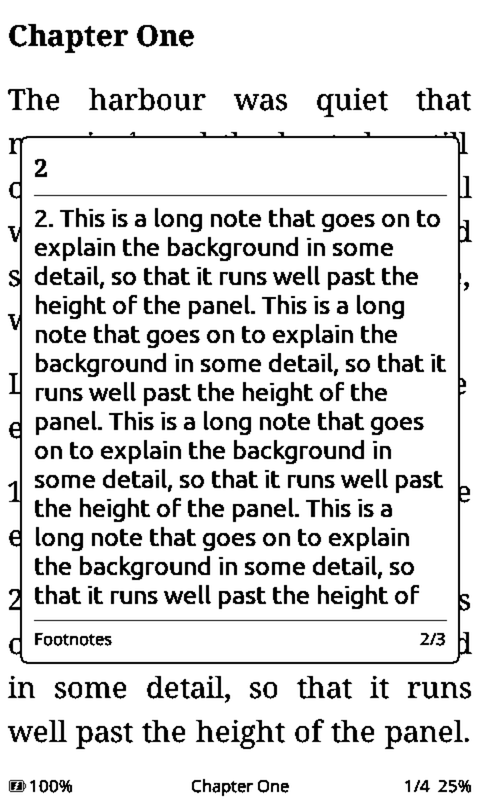</p>

### Dictionary Lookup

You can look up words with an offline dictionary on the SD card. To set it up:

1. Copy a StarDict dictionary into the `/dictionaries/` folder (or `/.dictionaries/`, see [6.7](#67-dictionary-files-and-language-selection)).
2. Select it in **Settings → Reader → Dictionary Settings → Fallback for other languages**. Inside a book, the same row in **Reader Settings** is called **Dictionary**.

To look up a word with the buttons, choose **Look Up** in the **[Reader Menu](#5-reader-menu)**. Use **Left** and **Right** to highlight a word, then press **Confirm** to see its definition. On button-only devices you can also start a lookup by holding **Confirm**, if **Long-Press Menu** in **Settings → Controls → Shortcuts** is set to **Dictionary**.

On a touch device, press and hold a word on the page. Its definition opens straight away. If your page turns use swipes only, a short tap on a word opens the definition and holding a word starts a clipping instead (see [3.6.7](#367-controls)). Page through a long definition with your page-turn gesture, and tap outside the card to close it.

See [docs/dictionary.md](docs/dictionary.md) for supported formats and where to find dictionaries.

### System Navigation

| Action                    | How                                                                                   |
| ------------------------- | ------------------------------------------------------------------------------------- |
| **Go to Home**            | Press **Back**. The book closes and the **[Home](#31-home-screen)** screen opens.      |
| **Go to Browse Files**    | Hold **Back** for about a second. The **[Browse Files](#33-browse-files-screen)** screen opens. |
| **Open the Reader Menu**  | Press **Confirm**. On a touch device, tap the middle of the page.                      |

**Short Back to File Browser** in **Settings → Controls → Shortcuts** swaps the two **Back** actions.

**Hold Confirm (button-only devices).** Holding **Confirm** does whatever **Long-Press Menu** is set to. The choices are **Bookmark** (adds or removes a bookmark), **KOSync** (opens KOReader Sync), **Dictionary** (starts a word lookup), **Create Clipping** (starts a text selection), **Links and footnotes** (opens the footnote panel) and **Disabled**, which is the default. A short press always opens the Reader Menu. Touch devices don't have this setting. There, the Power button or Home button shortcuts do these jobs.

### Supported Languages

The built-in reading fonts cover:

* **Latin script:** English, German, French, Spanish, Portuguese, Italian, Dutch, the Nordic languages, Polish, Czech, Hungarian, Romanian, Turkish, Vietnamese and many more.
* **Cyrillic script:** Russian, Ukrainian, Belarusian, Bulgarian, Serbian, Macedonian and others.

They also include a small Japanese set (kana and common kanji) so Japanese text can show up. Menus can also show Arabic and Hebrew.

For books in Chinese, Japanese, Korean, Arabic, Greek, Hebrew, Farsi or other scripts, install a font on the SD card. See [Custom Fonts (SD Card)](#38-custom-fonts-sd-card).

---

## 5. Reader Menu

<p align="center"></p>

Press **Confirm** while reading to open the Reader Menu. On a touch device, tap the middle of the page. Press **Back** to close the menu and return to your page.

The menu shows these entries, top to bottom. Some only appear when they apply to the book or the device.

| Entry | What it does |
| ----- | ------------ |
| **Select Chapter** | Opens the table of contents (see [5.1](#51-chapter-selection)). |
| **Links and footnotes** | Opens the footnote panel. Shown when the chapter has footnotes. |
| **Word Lookup** | Looks up words in Japanese and Chinese books (see [§6](#6-language-learning-features)). |
| **Translate Page** | Translates the page (see [6.2](#62-page-translation)). |
| **Reader Settings** | Font, spacing and other reading settings for this book. |
| **Bookmarks** | Lists this book's bookmarks. Shown once you have one. |
| **Toggle Bookmark** | Adds a bookmark on this page, or removes it if there is one already. |
| **Create Clipping** | Lets you select text and save it (see [5.3](#53-clippings-and-highlights)). |
| **View Clippings** | Lists this book's clippings. Shown once you have one. |
| **Night Mode** | Switches to white text on black. |
| **Frontlight** | Adjusts the light. Only on devices with a frontlight. |
| **Bluetooth Page Turner** | Connects a Bluetooth page turner. Only in builds that support it. |
| **Look Up** | Looks up a word in your StarDict dictionary. Shown once a dictionary is selected. Hidden in Japanese books, and in Chinese books that use Word Lookup. |
| **Auto Turn (Pages Per Minute)** | Turns pages automatically (see [Auto Page Turn](#auto-page-turn)). |
| **Go to %** | Jumps to a point in the book by percentage. |
| **Take screenshot** | Saves the screen as an image in the `screenshots/` folder on the SD card. |
| **Show page as QR** | Shows the text of the current page as a QR code, so you can scan it with your phone. |
| **Go Home** | Closes the book and opens the Home screen. |
| **Sync Progress** | Sends or fetches your reading position with a KOReader sync server (see [KOReader Sync Quick Setup](#3611-koreader-sync-quick-setup)). |
| **Delete Book Cache** | Deletes the saved page layout for this book and closes it. The book is prepared again the next time you open it. Your reading position is kept. |

**Reader Settings → Reader Menu Style** switches between this list (the default) and **Toolbar**. The toolbar is a strip at the bottom of the page with three tools: the table of contents, a quick text panel and **More**, which holds everything else from the list. The text panel has font, font size, line spacing, paragraph alignment and **Focus Reading**. In Japanese and Chinese books it has font, font size, line spacing, **Vertical Text** and **Furigana** (**Pinyin** in Chinese books).

### 5.1 Chapter Selection

Choose **Select Chapter** in the Reader Menu to see the table of contents.

1. Move through the list to the chapter you want.
2. Press **Confirm** to jump there.

Press **Back** to return to the Reader Menu without changing chapter.

---

### 5.2 Bookmarks

A bookmark saves your place so you can come back to it later.

**To add a bookmark**, choose **Toggle Bookmark** in the Reader Menu. A short message says **Bookmark Added.** Choosing it again on the same page removes the bookmark. On button-only devices you can also hold **Confirm**, if **Long-Press Menu** is set to **Bookmark** (see [System Navigation](#system-navigation)).

**To open a bookmark**, choose **Bookmarks** in the Reader Menu, highlight one and press **Confirm**.

**To rename or delete a bookmark**, hold **Confirm** on it for about a second (on a touch device, press and hold the row). Choose **Rename** or **Delete**. Delete asks you to confirm first.

### 5.3 Clippings and Highlights

A clipping saves a passage you have selected and highlights it on the page.

**With buttons:** choose **Create Clipping** in the Reader Menu. Move to the first word and press **Confirm**, then move to the last word and press **Confirm** again to save. **Back** clears the selection. Press **Back** again to leave.

**With touch:** press and hold a word. Its definition opens, with a handle on each side of the word. Drag a handle to turn the lookup into a selection. If your page turns use swipes only, holding a word starts the selection right away. Drag the handles to set the start and end, then tap one of the buttons above the selection: **Look Up**, **Translate** (with Gemini, see [6.2](#62-page-translation)), **Clip** or **Bookmark**.

To carry a selection onto the next page, hold the end handle on the last word for a second. A selection can cover up to three pages of the same chapter. To remove a clipping, press and hold its highlighted text.

Highlights stay in place even after you change the font, spacing or screen orientation.

**View Clippings** lists this book's clippings. Press **Confirm** on one to read it or go to its passage. Hold **Confirm** to delete it.

Clippings are also added to `My Clippings.txt` in the main folder of the SD card, in the same format Kindle uses. Very long clippings are shortened there. If you move or rename a book, its clippings move with it. Deleting a book deletes its clippings, but `My Clippings.txt` is not changed.

If you use a CrossPoint Sync server, turn on **Sync Clippings** in the KOReader Sync settings. Your clippings then sync together with **Sync Progress**. Leave it off for an ordinary KOSync server.

**Vertical text.** Selection works the same way on vertical pages, but it moves one character at a time. A run of Latin letters or digits counts as one character. The side buttons move along a column, and **Left** and **Right** jump between columns. **Left** moves forward, in reading direction. On touch, the handles sit above and below the selection. A vertical selection can't go past the current page.
## 6. Language Learning Features

Matcha Reader adds tools for learning a language while you read. They were built first for **Japanese** and
**Chinese** (Mandarin in simplified or traditional characters, and Cantonese). Most of them also work for books in
other languages.

You need a few files on the SD card first. The [README's Setup](README.md#setup) lists the steps, and
[docs/dictionary-setup.md](docs/dictionary-setup.md) explains which dictionary to get for each language.

| If you read | Start with | Then |
| --- | --- | --- |
| Japanese | [6.3 Japanese Books](#63-japanese-books) | 6.1, 6.2, 6.6 |
| Mandarin, simplified or traditional | [6.4 Chinese Books](#64-chinese-books) | 6.1, 6.2, 6.6 |
| Cantonese | [6.4 Chinese Books](#64-chinese-books) | 6.1, 6.2, 6.6 |
| French, English or another language | [6.5 Books in Other Languages](#65-books-in-other-languages) | 6.1, 6.2 |

Every EPUB says which language it is in (e.g. `ja`, `zh`, `zh-TW`, `yue` or `fr`). The reader uses that to pick
the dictionary, the font and the page layout. If a Japanese or Chinese book has no language or the wrong one, the
reader works it out from the text. You can also set it by hand: see [Book Language](#book-language) in 6.4.

### 6.1 Word Lookup

Word Lookup shows the dictionary entry for a word on the page.

**Opening it**

- Open the reader menu and choose **Word Lookup**. It is listed for Japanese and Chinese books once their
  dictionary is installed.
- On a touch device, hold your finger on a word. Its entry opens straight away.
- For one-press access, go to **Settings → Controls → Shortcuts** and set **Short Power Button Click** to
  **Word Lookup**. A side button can be set to **Word Lookup** on the same screen.

Lookup opens on the page you were reading, vertical or horizontal, with one word highlighted. On a touch device
you can then tap any word to open its entry.

**Moving between words**

| Button | Vertical text | Horizontal text |
| --- | --- | --- |
| Side buttons (Up / Down) | Previous / next word in the column | Line above / below |
| Left / Right | Next / previous column (Left moves forward, as the text runs) | Previous / next word on the line |

These directions follow the screen, so in landscape the side and front buttons swap roles.

| Button | Action |
| --- | --- |
| **Look Up** (Confirm) | Open the entry for the highlighted word |
| Back | Return to reading |
| Power (short click) | Open the entry, when **Short Power Button Click** is set to **Word Lookup** |

No button labels are shown on this screen. A label bar would cover the last line of text.

The highlight starts in the middle of the page, so no word is more than half a page away. Only words the dictionary
knows can be highlighted. A page you looked at before opens faster, with the highlight on the word you last
picked.

**In the entry**

- **Back** returns to the page with the same word highlighted, so the next word is a few presses away.
- **Select** (Confirm) saves the word for sentence mining (see below).
- A short power click closes the dictionary, when the shortcut above is set.
- On a touch device, a tap outside the entry closes the dictionary and returns to the book.

Some words have more than one entry. A Japanese word may be in both the vocabulary and the grammar dictionary,
and a Chinese word may have several readings. Each entry gets its own page. Use Left / Right to move between
them and Up / Down to scroll a long entry.

**In manga**, lookup opens straight in the entry view:

| Button | Action |
| --- | --- |
| Left / Right | Previous / next word on the page |
| Up / Down | Scroll a long entry |
| Select | Save the word and its sentence for sentence mining (see below) |
| Back | Return to reading |
| Power (short click) | Same as Back, when **Short Power Button Click** is set to **Word Lookup** |

The bottom of the entry shows where you are (e.g. 10/35) and which dictionary answered (e.g. `Vocab | JMdict` or
`Vocab | CC-CEDICT`). You only land on words the dictionary has. When stepping from word to word in manga, each word
shows one entry so stepping stays quick.

**Settings**

- **Settings → Controls → Navigate with Side Buttons in Word Lookup**: in the entry, the side buttons move between
  words or entries and Left / Right scroll. This has no effect when both side buttons have their own custom action.
- **Reader Settings → Word Lookup Font Size**: **Tiny**, **Small** (default), **Medium** or **Large**.

#### Sentence mining

Sentence mining saves a word together with the sentence you found it in, as a flashcard for
[Anki](https://apps.ankiweb.net/). It works in books in every language and in manga, manhua and comics.

**To save a word**, open its entry and then:

- **On a touch device** (X4 Pro, Papermono, Sticky): tap the **+** in the top-right corner of the entry (circled
  below).
- **On a button device** (X4, X3, X4 Classic): press **Select**. There is no **+** on these devices.

<p align="center">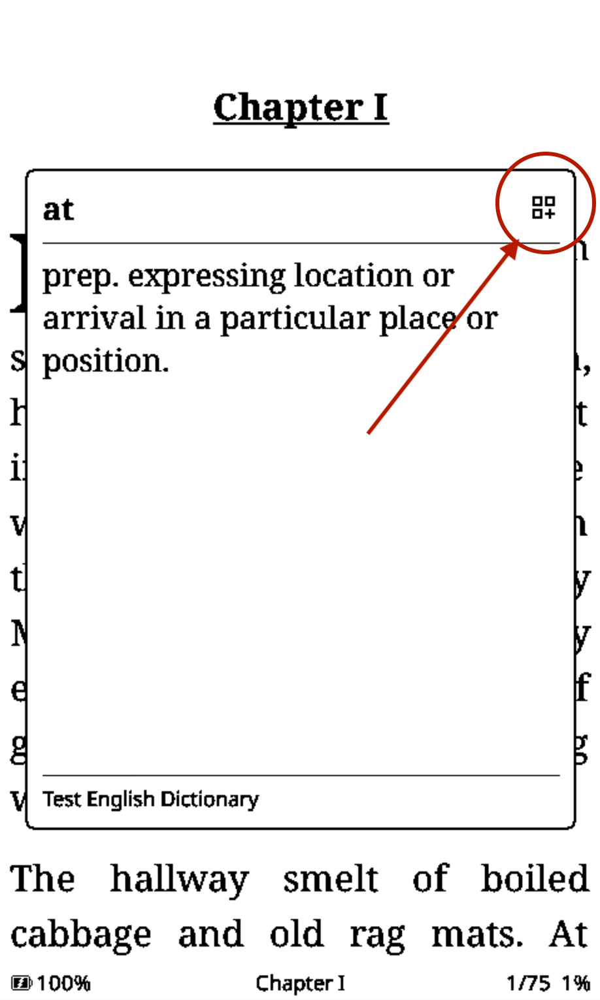</p>

A short **Saved** message appears, and the corner shows a check until you move on. If the SD card could not be
written, you see **Could not save**.

Each word is saved once per sentence. Saving the same word from the same sentence again adds nothing, even days
later. The same word in a different sentence makes a new card.

**Where the cards go:** the **sentence-mining** folder on the SD card, with one file per language, e.g.
`sentences-ja.csv`, `sentences-zh.csv`, `sentences-yue.csv` or `sentences-en.csv`. That way each language can go
into its own Anki deck. Each card holds:

| Column | Contents |
| --- | --- |
| Word | The word in its dictionary form, e.g. 漏らす |
| Reading | Kana for Japanese (もらす). Pinyin for Chinese, plus zhuyin or jyutping when the dictionary has them. Empty for other languages |
| Sentence | The sentence it came from, with the word in bold |
| Definition | The dictionary entry (a very long one is shortened) |
| Book, Author | Where it came from |
| Date | The day you saved it |
| Dictionary | Which dictionary answered |
| Tags | `matcha` and the book title |

A sentence cut off at the bottom of the page is completed from the next page. In manga, the sentence is the text of
the speech bubble the word is in.

**Importing into Anki**

1. Copy the CSV file to your computer.
2. In Anki, choose **File → Import** and pick the file.

The file tells Anki how it is laid out, so you do not need to set up columns. The file keeps growing as you save
more words. You can import the same file again later: Anki updates the cards it already has and adds only the new
ones.

The file is plain CSV, so a spreadsheet or another flashcard app can open it too.

**The date** comes from the device clock, which is set whenever the device connects to Wi-Fi. The X4 has no clock
chip and loses the time on a restart, so the date can be wrong or empty until the next Wi-Fi connection. To set
the clock at any time, see [Syncing the Clock](#syncing-the-clock).

### 6.2 Page Translation

Reader menu → **Translate Page** translates the current page into English.

**Before the first use**, get a Gemini API key from Google and save it as a text file named `gemini.key` in the
`/.system/` folder on the SD card. A `/system/` folder works too. The dotted name hides the folder in the file
browser.

**What happens**

1. The reader connects to the last Wi-Fi network you used. If there is none, or it does not answer, the Wi-Fi list
   opens. Pick a network and the translation continues.
2. "Translating..." shows while it works.
3. The translation opens in a panel over the page. A long one is split into pages: turn them with Left / Right,
   the page buttons or your usual page-turn gesture.
4. Press Back, or tap outside the panel, to return to the book.

<p align="center">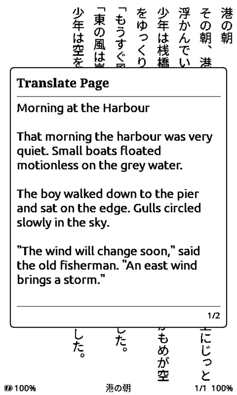</p>

### 6.3 Japanese Books

Copy a Japanese EPUB to the SD card and open it from the Library. A Japanese novel set to read right to left opens
in vertical text, other Japanese books horizontally. To open every Japanese book one way, set **Settings → Reader →
Tategaki (vertical Japanese)** to **On** or **Off**. A book with no language set, or the wrong one, is recognised
from its kana the first time you open it.

**Furigana.** The reader shows the furigana that a book already has. It cannot add furigana itself. For a book
without them, you can add them once on a computer before copying the book to the card:

```bash
python3 tools/furigana_ruby/add_furigana_ruby.py --ai --gemini-key-file gemini.key book.epub book-furigana.epub
```

The script sends the book's text to Google's Gemini, sentence by sentence, using your own API key (the same key
Page Translation uses). Gemini reads each word in its sentence, which is needed because a kanji's reading depends
on the word around it. Furigana the book already has stays as it is. A reading is added only when it fits the word
as written (in 食べる, た goes over 食 and べる stays bare). Words that do not fit are left without furigana.

**Switches.** For a Japanese book, **Reader Settings** has a **Vertical Text** and a **Furigana** switch. Open
Reader Settings from the reader menu. Your choice is saved for that book and applies when you return to it.

<p align="center">
  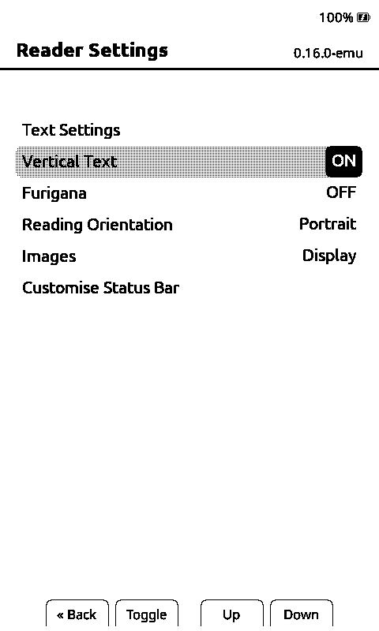
  
</p>
<p align="center"><em>The switches, and furigana beside the kanji where the book has them</em></p>

**Word Lookup in Japanese** (see 6.1):

- **Conjugated forms are found.** 読んで finds 読む, and 食べませんでした finds 食べる. The entry shows the dictionary
  form.
- **Three dictionaries:** vocabulary, names and grammar. A word in both the vocabulary and the grammar dictionary
  gets one page for each. For short grammar words such as こと or よう, the grammar page opens first.
- **The book's own readings come first.** If the book puts furigana on a word, its entry starts with
  "In this book:" and that reading (e.g. はやし).
- **Words split across pages still work.** Lookup reads a few characters onto the next page, so picking the part
  you can see finds the whole word.

<p align="center">
  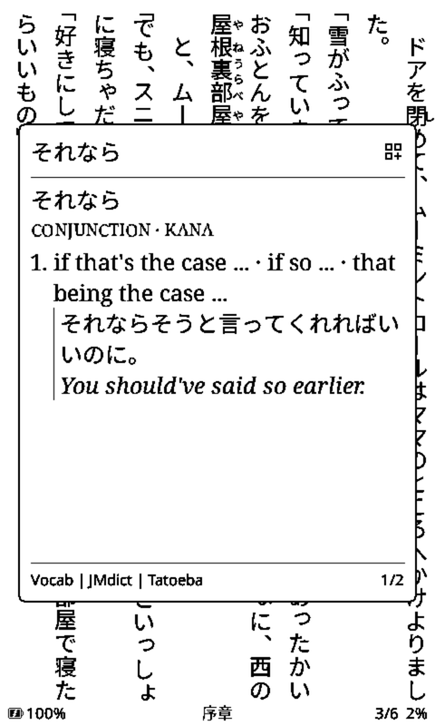
  
</p>

**Files.** Dictionaries go in `dictionaries/jp/` (see 6.7). A Japanese font is built in. A Noto Sans JP or Noto
Serif JP font on the card looks better and adds rare kanji ([3.8](#38-custom-fonts-sd-card)). Saved words go to
`sentences-ja.csv` with their kana reading.

### 6.4 Chinese Books

Chinese books work like Japanese ones once a dictionary and a font are on the card. The reader tells three kinds
apart by the book's language:

| | Mandarin, simplified | Mandarin, traditional | Cantonese |
| --- | --- | --- | --- |
| Book language | `zh-CN`, `zh-Hans`, `zh-SG` | `zh-TW`, `zh-Hant`, `zh-HK`, `zh-MO` | `yue` |
| Dictionary folder | `dictionaries/zh/` | `dictionaries/zh/` | `dictionaries/yue/` |
| Dictionary | CC-CEDICT | CC-CEDICT, with the MoE 重編國語辭典 entry below it | CC-Canto and CC-CEDICT together |
| Reading in the entry | Pinyin | Pinyin and zhuyin | Pinyin and jyutping |
| Level in the entry | HSK | TOCFL | none |
| Font | Noto Sans SC | Noto Sans TC | Noto Sans TC |
| Text direction | Horizontal | Vertical when the book reads right to left, otherwise horizontal | Same as traditional |
| Punctuation in vertical text | 。，、 in the upper right of their square | 。，、 centred in their square | Same as traditional |
| Saved words | `sentences-zh.csv` | `sentences-zh.csv` | `sentences-yue.csv` |

A book marked only `zh` or `cmn` does not say which script it uses. The reader decides from its characters.

The reading and level rows describe the ready-made dictionary packs in
[docs/dictionary-setup.md](docs/dictionary-setup.md). If you convert a dictionary yourself, you choose what it
shows: `--zhuyin` adds zhuyin, `--levels` adds a level and `--examples` adds example sentences.

The `zh/` folder serves both scripts, because every word is stored in its simplified and its traditional form. So
a simplified book works with the traditional pack, and the other way round. Install the one that matches what you
study. Cantonese has its own folder because it has words a Mandarin dictionary does not list.

Without a converted Chinese dictionary, the reader falls back to the basic StarDict lookup, which picks only one
character at a time. Install or convert the dictionary first (see 6.7).

#### Book Language

When a book has no language set, or a language other than Japanese or Chinese, the reader checks its text the first
time you open it. Kana mean Japanese. A page that is mostly Chinese characters means Chinese, simplified or
traditional depending on the characters.

If the guess or the book's own setting is wrong, open **Reader Settings → Book Language** and pick **Auto**,
**Japanese**, **Chinese (Simplified)**, **Chinese (Traditional)** or **Cantonese**. The choice is saved for that
book and applies when you return to it. The reader never guesses Cantonese, so set it here for a Cantonese book
that is not marked `yue`.

#### Word Lookup in Chinese

Lookup works as described in 6.1. Some things are specific to Chinese:

- **The page is split into dictionary words**, and the highlight lands only on words that have an entry. Chinese
  words do not change form, so every word is looked up as written. If the dictionary was converted with a
  `--frequency` list, the reader prefers the common split (结婚的和尚未结婚的 reads 和 + 尚未, not 和尚).
- **The entry** shows the pinyin first (with zhuyin or jyutping after it), then the HSK or TOCFL level, then the
  word in the other script when it differs (`說話 / 说话`), then the meanings, then up to two example sentences
  with translations.
- **Several readings or dictionaries** each get a page, e.g. 好 hǎo and 好 hào, or the CC-CEDICT and the MoE
  entry. Use Left / Right to move between them.
- **Names and grammar.** A dictionary converted with `--split-names` marks proper nouns as **Name** entries. A
  Chinese grammar list, if installed, works like the Japanese one.

#### Pinyin Above the Text

Like furigana, pinyin (or zhuyin) above the characters has to be in the book. The reader cannot add it, and
there is no setting for it. To add it, process the book once on a computer before copying it to the card:

```bash
python3 tools/pinyin_ruby/add_pinyin_ruby.py --cedict cedict_1_0_ts_utf-8_mdbg.txt book.epub book-pinyin.epub
```

Useful options:

- `--ai --gemini-key-file gemini.key` lets Gemini pick each character's reading from its sentence. Recommended,
  see below.
- `--zhuyin` writes zhuyin (bopomofo) instead of pinyin.
- `--frequency dict.txt --skip-top 1500` leaves the 1,500 most common words without pinyin, so only the words you
  are likely to need get a reading.

You need Python and the CC-CEDICT file ([docs/dictionary-setup.md](docs/dictionary-setup.md)). Copy the new EPUB to
the card and open it. **Reader Settings → Pinyin / Zhuyin** shows or hides the readings and is saved per book. It
is the same switch Japanese books call **Furigana**.

**Why `--ai` helps.** Without it, readings come from the dictionary. Many characters have more than one reading,
and a character on its own gets the first one listed, which is often wrong (石 comes out as *dàn* instead of
*shí*). With `--ai`, the book's text is sent to Gemini, sentence by sentence, under your own API key (the same key
Page Translation uses). Gemini picks each reading from the sentence. The script uses Gemini's reading only if
CC-CEDICT lists it for that character, so it cannot add a made-up reading. This takes a while: roughly a minute
per thousand characters, so a whole novel is a long run.

<p align="center"></p>

#### Vertical Text

The layout follows the publisher. A book set to read right to left (common for novels from Taiwan) opens in
vertical columns. Every other Chinese book opens horizontally. To open every Chinese book one way, set **Settings →
Reader → Zhípái (vertical Chinese)** to **On** or **Off**. The **Vertical Text** switch in a book's **Reader
Settings** overrides both and is saved per book.

#### Fonts and the Interface

The built-in font covers common Japanese characters only, so a Chinese book needs a font on the card: **Noto Sans
SC** for simplified, **Noto Sans TC** for traditional and Cantonese. Convert one with the browser tool (README
Setup step 3). When these fonts are published for download, **Manage Fonts** will offer them too. It is the last
row of the font list in **Reader Settings → Text Settings**. The reader picks the font that matches the book's
language, and each profile can also keep a font of its own.

With only a Japanese font on the card, Chinese shows in Japanese letter shapes. It is readable, but it does not
look like a printed Chinese book. With no font on the card, many everyday simplified characters show as empty
boxes.

Home, the Library, the file browser, the OPDS browser and the language list use the same font for names with
characters the built-in font lacks, so Chinese titles show correctly there too.

To switch the menus themselves to 简体中文 or 繁體中文, install a language pack
([3.9](#39-language-packs-sd-card)).
### 6.5 Books in Other Languages

French, English, German and every other language use ordinary StarDict dictionaries, which need no conversion.
Put each one in `dictionaries/<language>/<name>/` (see 6.7). A book tagged with that language then picks it
automatically. Word Lookup (6.1), sentence mining and Page Translation (6.2) work as they do in a Japanese or
Chinese book. One difference: the cursor stops on every word, including words the dictionary does not have.

**Word forms.** Words on the page are often not in the form the dictionary lists. When a lookup finds nothing,
the reader tries again with other forms of the word. It checks the dictionary's own `.syn` file first, if there
is one, and then the rules for the book's language. In every language a capital letter at the start of a
sentence is ignored, accents included, so `École` finds `école` and `Über` finds `über`.

French has extra rules:

| On the page | Looks up |
| --- | --- |
| `l'eau`, `qu'il`, `jusqu'ici` | `eau`, `il`, `ici` (the short article or pronoun is dropped) |
| `journaux`, `bijoux`, `livres` | `journal`, `bijou`, `livre` |
| `heureuse`, `chanteuse`, `nouvelle`, `première` | `heureux`, `chanteur`, `nouveau`, `premier` |
| `parlaient`, `parlé`, `mangeons`, `commençait` | `parler`, `manger`, `commencer` |
| `finissent`, `choisirait`, `vendu`, `attendait` | `finir`, `choisir`, `vendre`, `attendre` |
| `éteignit`, `connaissons`, `conduisit`, `lentement` | `éteindre`, `connaître`, `conduire`, `lent` |
| `songeai-je`, `pense-t-il` | two words you can select separately, `songeai` and `je`. Fixed compounds like `rendez-vous` stay one word. |

English, and every language without its own rules, gets basic rules for plurals, possessives and verb endings
(`dogs` → `dog`, `stories` → `story`, `running` → `run`).

The rules only handle regular forms. Some French verbs look nothing like their infinitive (`est` and `fut` for
*être*, `ont` and `eut` for *avoir*, `vais` for *aller*). No rule can find those. For them the dictionary needs a
`.syn` file in its folder. Many dictionaries come with one; see [docs/dictionary.md](docs/dictionary.md).

### 6.6 Manga, Manhua and Comics

Japanese manga, Chinese manhua and comics in other languages all open in the same reader. You set the book's
language when you convert it (`--language ja`, `zh`, `yue`, `fr` and so on). That language decides which
dictionary is used for the speech bubbles.

Looking up words inside the pictures works for Japanese, Mandarin and Cantonese, because it needs the converted
dictionaries in `dictionaries/jp/`, `zh/` or `yue/`. A comic in another language still reads normally, but word
lookup in its speech bubbles is not supported yet.

Convert the book with [Matcha Reader Tools](https://eszter007.github.io/matcha-reader-tools/) and pick the X3 or
X4 target, so the pages are sized for your screen. Then copy the folder anywhere on the SD card. Any folder name
and depth works. The book shows up in the Library grid, on shelves and in Continue Reading with its cover, title,
author and progress.

| Button | Full-page view | Panel zoom |
| --- | --- | --- |
| Page turn | Zooms in on the first panel | Next panel, then the next page |
| Confirm | Reader menu | Reader menu |
| Back | Leave the book | Back to the full page |
| Hold Back | Open the file browser at the book's folder | Open the file browser at the book's folder |

<p align="center">
  
  
</p>

#### Looking up words in the picture

You can pick a single word straight out of a speech bubble. This works on the full page and on a zoomed panel,
also when **Rotate Panels** has turned the panel sideways.

- **By touch:** hold your finger on the word and its dictionary entry opens. A hold slightly next to the word
  still finds it, e.g. in the gap between two columns or beside the small reading characters (furigana). A hold on
  the artwork does nothing.
- **With buttons:** start **Word Lookup** from the reader menu, or with the power button or a side button set to
  Word Lookup. The page stays on screen and one word gets a frame around it. The page-turn buttons move the frame
  from word to word, in the same direction they turn pages. **Confirm** looks the word up. On the X4 Pro the
  **Home** key does the same. When you close the entry you are back on the same word, so the next one is one
  press away. **Back** stops selecting.

The frame is thin, so you can still read the word inside it. A word that runs on into the next column gets a frame
in each column (or on each line, in horizontal text).

<p align="center">
  
  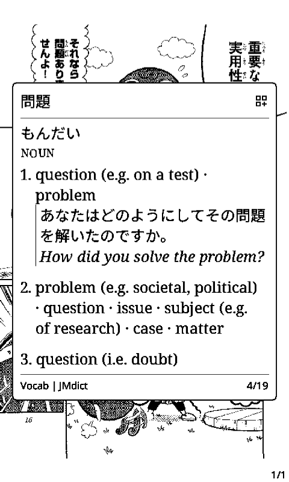
</p>

Selecting single words needs manga converted with the current
[Matcha Reader Tools](https://eszter007.github.io/matcha-reader-tools/) or `convert_manga.py`, because they save
where each line of text sits on the page. Manga converted with an older version still works. There, Word Lookup
shows the panel's text as a list, and holding a word does nothing. Convert the book again to get word selection.
Converting again costs the same as the first time.

Two options change how panels are shown:

| Option | Where | Effect |
| --- | --- | --- |
| **Rotate Panels** | Settings → Reader | On by default, and applies to every manga. A panel whose shape does not fit the screen is turned sideways so it fills the display, and you turn the device to read it. When it is off, every panel stays upright. It is smaller, but you never have to turn the device. |
| **Panels Only** | Reader menu | Saved per book. Skips the full-page view and goes straight from panel to panel. When it is off, you see each full page first and then its panels. A page with no panels found still shows as a full page. Only offered for books that have panels. |

Manga converted without full-page images always opens in panel view.

Reaching the last page marks the manga as finished in your reading insights, the same as an EPUB.

### 6.7 Dictionary Files and Language Selection

The reader picks the dictionary from the book's language tag, so you can keep several dictionaries and never
switch by hand. Each dictionary goes into a folder named after its language code, e.g. `de` for German, `en` for
English, `fr` for French. Inside that language folder, make one more folder with your dictionary's name and put the
files there.

```
dictionaries/
  en/your_dictionary_name/     # English, StarDict files
  fr/your_dictionary_name/     # French, StarDict files
  jp/                          # Japanese, converted Yomitan files
    vocab.idx    vocab.dat    vocab.spx      # vocabulary (required)
    names.idx    names.dat    names.spx      # names (recommended)
    grammar.idx  grammar.dat  grammar.spx    # grammar reference (optional)
  zh/                          # Mandarin, converted CC-CEDICT (simplified and traditional books alike)
    vocab.idx    vocab.dat    vocab.spx    vocab.title    # vocabulary (required)
    names.idx    names.dat    names.spx    names.title    # proper nouns (optional)
    grammar.idx  grammar.dat  grammar.spx  grammar.title  # grammar patterns (optional)
  yue/                         # Cantonese, converted CC-Canto + CC-CEDICT
    vocab.idx    vocab.dat    vocab.spx    vocab.title
```

StarDict files placed straight into `fr/` without a name folder are not picked up for French books.

**Unpack compressed StarDict dictionaries.** Many come as a compressed `.dict.dz`. Looking a word up in one needs a
32 KB block of free memory, which a reader with a book open often lacks, and the lookup then fails with **Not Enough
Memory**. An unpacked `.dict` needs no such block. When you upload a `.dict.dz` through **File Transfer**, keep
**Unpack dictionary** ticked: the browser unpacks it, uploads only the `.dict`, and deletes an older `.dict.dz` of
the same name from that folder. If you copy files to the card yourself, unpack it first: on macOS and Linux run
`gzip -dc name.dict.dz > name.dict`. On Windows, 7-Zip's **Extract Here** does it; name the result `name.dict`. The
`.dict` is about seven times larger. The reader uses it whenever it is there, so the `.dict.dz` can go.

**Japanese and Chinese** need converted files in `dictionaries/jp/`, `dictionaries/zh/` and `dictionaries/yue/`.
A plain StarDict file will not work for them, because the reader uses the dictionary to work out where each word
on the page starts and ends.

Japanese comes in three parts: vocabulary, names and grammar. Convert them with
[Matcha Reader Tools](https://eszter007.github.io/matcha-reader-tools/) from
[Jitendex](https://github.com/stephenmk/Jitendex), [JMnedict](https://github.com/JMdictProject) or any other
Yomitan dictionary. The tool also accepts jmdict-simplified JSON and MDict `.mdx` files.

Chinese converts in the same browser tool, or with the script in `tools/dict_convert/` and `--lang zh`. It accepts
the CC-CEDICT text file, the MoE 重編國語辭典 JSON, a Yomitan zip or an `.mdx` file.
[docs/dictionary-setup.md](docs/dictionary-setup.md) has the commands. One `zh/` folder serves simplified and
traditional books alike: every entry can be found under both forms, and the entry shows the other form under the
reading. `vocab.title` sets the dictionary name shown at the bottom of the entry.

Ready-made Chinese packs, one simplified and one traditional, are linked from
[docs/dictionary-setup.md](docs/dictionary-setup.md). Install only one of them, since both use the `zh/` folder.
For Cantonese (`yue`), convert with `--lang yue`.

**Several dictionaries in one language.** Give each one its own folder, e.g. `en/collins/` and `en/wiktionary/`.
A lookup searches up to four dictionaries for the book's language and shows every entry it finds, one after the
other. Page past the end of one entry and the next dictionary's entry opens. Page back from its first page and you
return to the last page of the previous one. The bottom line names the dictionary and its place in the list, e.g.
`Collins (1/2)`. The dictionary chosen under **Settings → Reader → Dictionary Settings → Fallback for other languages** comes first if it is in the
book's language. The others follow in folder-name order. A saved sentence records the dictionary whose entry was on
screen. The first lookup in a newly added dictionary takes longer, because the reader prepares the dictionary
for searching.

<p align="center">
  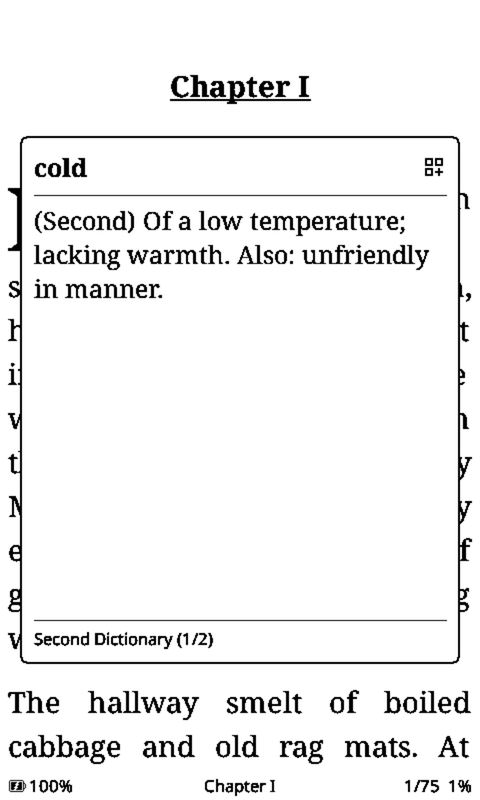
  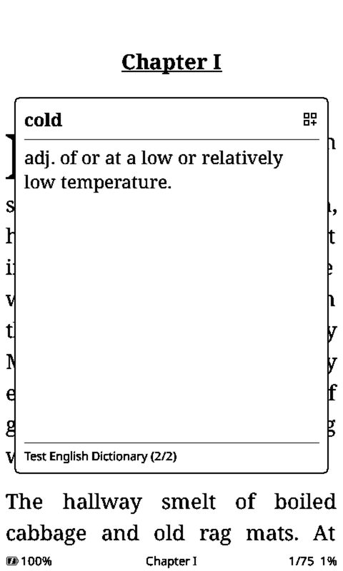
</p>

**Settings → Reader → Dictionary Settings → Fallback for other languages** is used when a book has no language tag, or when no folder under
`dictionaries/` matches its language. Inside a book, the reader settings show a **Dictionary** row with the
dictionary that book uses first. Use it to check that the book's language tag was recognised.

You can also name the folder `.dictionaries/`, which hides it from the file browser. Everything above works the
same there. If both folders exist, StarDict dictionaries are found in either one. For `jp/`, `zh/` and `yue/`,
the copy in `.dictionaries/` wins.

Older setups still work. A dictionary folder placed directly under `dictionaries/`, outside a language folder, can
still be chosen as the fallback dictionary. Japanese files in the old `dict/` folder are still found.


## 7. Reading Insights

Reading time is saved every five minutes and again when you close a book. If the battery runs out or the device
crashes, you lose at most the last few minutes. Manga counts the same as EPUBs.

With the CrossPoint sync server, **Sync Progress** also uploads these insights; see [Syncing While Reading](#syncing-while-reading).

### 7.1 Insights

Go to Home → **Insights**. It shows your current streak, minutes this week, books finished, days read, total
reading time, your longest streak and a calendar of the days you read.

The tabs at the top split these numbers by language. **All** covers everything. After it comes one tab for each
language you have read. Each tab has its own streak, calendar and totals, so reading an English book does not
break your Japanese streak.

To hide the language tabs and keep only the totals, turn off **Settings → Insights → Show language insights**. Books
that declare no language get an **Unknown** tab only with **Hide unknown languages** turned off.

A tab shows the language's name if the firmware has a translation for it, e.g. `ja` shows as 日本語. Otherwise it
shows the language code, such as `ZH`. Books with no language tag (TXT, XTC and manga converted without
`--language`) are collected in an **Unknown** tab.

| Button | Action |
| --- | --- |
| Confirm | Next tab. After the last tab, the cursor moves into the bottom tab bar (Cover Grid theme). |
| Left / Right | Previous or next month in the calendar. The button hints show which month you will move to. |
| Up / Down | Scroll. At the end of the page, Down selects **Refresh Insights** and the next Down moves the cursor into the bottom tab bar. From there, Down goes back to the top of the page and Up to its end. |
| Back | Back one screen. Hold it to go Home. |

On a touch device, tap a tab or swipe left and right across the page to switch tabs. Tap the arrows next to the
month to change it.

**Refresh Insights** at the bottom of the page syncs your insights with the CrossPoint sync server; see
[Syncing Insights Between Devices](#74-syncing-insights-between-devices).

<p align="center">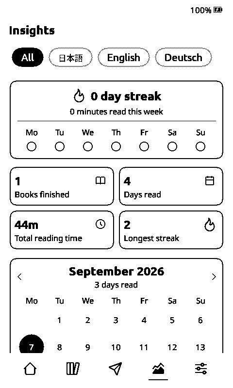</p>

### 7.2 Per-book Insights

Long-press a book in the Library and choose **View Insights**. You see sessions, total reading time, average session,
days read, words looked up, sentences saved and a calendar of the days you read that book. The header shows the
day you started the book and the day you finished it, or "since" the start while you are still reading. On the
calendar the start day has a dotted ring and the finish day a solid one.

Dates are shown the way your interface language writes them, e.g. 17.10.2026 in German or 2026年10月17日 in
Japanese (the end-of-book stamp uses the shorter 2026.10.17 there). The device stores them in one fixed format,
so switching language changes only how they look.

**Words looked up** counts each word whose entry you opened, once each time you open the lookup screen. Moving
back and forth over the same word does not count it twice. **Sentences saved** counts the cards added to your
sentence-mining file.

A session is one opening of the book. Opening the reader menu or settings in between does not start a new one.
Waking the device from sleep back into the book does, so an evening with a few sleeps in it shows as several
sessions.

Books you read before per-book insights existed show "No reading recorded yet" until you open them again. Your
Insights totals still include that reading.

<p align="center">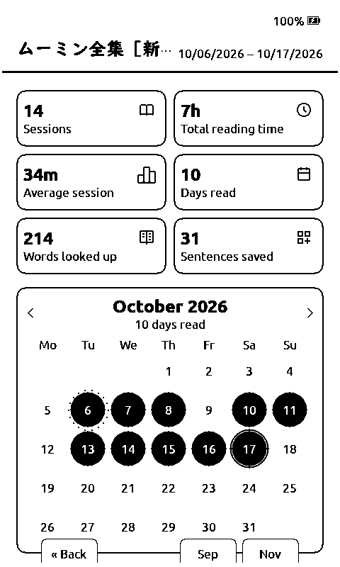</p>

#### Finishing a book

Turning past the last page opens the end-of-book screen, for every type of book. It marks the book as finished
and tells you which number book this is for you, overall and in that language. The stamp on the cover (読了 for
Japanese books) shows the day you started the book and, in bold, the day you finished it. Opening a finished book
again keeps that day. The ticket below shows the reading time, the days from your first to your last reading day
and, if any, the words you looked up and the sentences you saved. Below that you find the next book in the same folder under
**Continue with:** and a **Go to Home** button. A short press of Back takes you back to the last page.

Books finished before the finish day was saved show their last reading day before today instead.

<p align="center">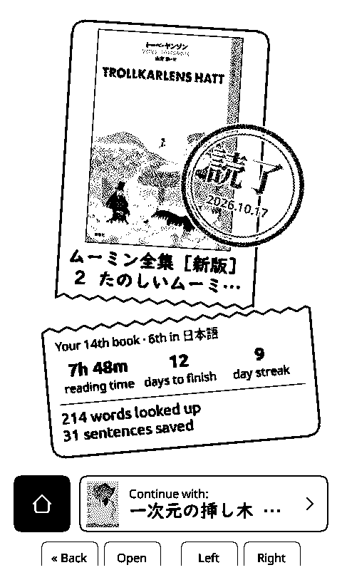</p>

### 7.3 What the Numbers Do Not Cover

- Reading time counts in whole minutes. A very short sitting adds nothing, and the average session comes out a
  little low.
- Books finished per language can be too low. The device remembers the language of the 150 books you read most
  recently. A book you finished long ago may have lost its language tag.
- Days read before per-language tracking existed have no language and cannot get one now.
- The device keeps about ten years of overall history and a few years of history per language. Older days are
  dropped.

### 7.4 Syncing Insights Between Devices

With the CrossPoint sync server set up (see [Syncing While Reading](#syncing-while-reading)), select **Refresh Insights**
at the bottom of Insights or **Settings → Insights → Sync Insights**. The device joins Wi-Fi, sends its insights and fetches
the reading time saved on the server, shows **Done** and restarts back to where you started.

What comes back is what any CrossPoint reader on your account uploaded:

- your reading time per day for the last two years: the **All** tab's streak, days read, total time, week and
  calendar;
- the language tabs, from each book's days and language;
- books finished, including ones not on this card;
- each book's own insights (days, sessions, finished), for the books on the card. A book takes them in the next time you
  open it or its insights.

A day that already has more minutes on the device keeps them, so syncing twice never counts anything double. The
numbers show after the restart that ends the sync. Dictionary lookups and saved sentences stay on the device that
recorded them.

Books are matched by file name, so keep the same name on every device. The server only has per-book days and
languages if it supports them; an older server brings back the **All** tab only.

With **Settings → Insights → Insights data** on **All devices** (the default), each sync also fetches the account's
numbers as the CrossPoint app counts them, overall and per language: reading days, streaks, books finished, reading
time and this week. Insights and the **Insights** sleep screen then show those, so a day read on any device or in the app
counts, and a language read only elsewhere gets its own tab. What you read on this reader after the sync is added on
top until the next one. Other devices' numbers are only shown, never uploaded as this reader's. Until the account you
are signed in with has synced once, Insights shows this device only.

## 8. Current Limitations & Roadmap

This firmware is still in active development. These things do not work fully yet:

* **Cover images:** a large cover image in an EPUB can take several seconds to prepare for the sleep screen and
  the Home thumbnail (around 10 seconds for an image about 2000 pixels tall). To speed this up, shrink the images
  in the EPUB, e.g. with https://github.com/bigbag/epub-to-xtc-converter.
* **Images in books:** most JPG, PNG and GIF images show correctly, book covers included. Animated GIFs show only
  their first frame. Interlaced GIFs show a placeholder instead. Progressive JPEGs show at reduced sharpness, so
  fine detail is lost. One rare kind of progressive JPEG does not show at all. If an image is missing, save it
  again as a normal (baseline) JPEG, e.g. with `jpegtran -copy none -optimize`, or run the book through the manga
  converter.

---

## 9. Troubleshooting Issues & Escaping Bootloop

If something goes wrong or the device crashes, please open an issue on GitHub and attach the logs.

**Crash report on the SD card:** after a crash, the firmware saves a file called `crash_report.txt` in the top
folder of the SD card. You do not need a USB cable for this. Attach the file to your bug report.

**Serial monitor logs:** for more detail, connect the device to a computer with USB and run the debugging monitor
script. It needs Python 3 and a few packages, which you install with `pip3 install pyserial colorama matplotlib`
(add `pillow` if you want screenshots saved as images):

```
python3 scripts/debugging_monitor.py
```

The script finds the device on its own. You can also name the port yourself:

```
python3 scripts/debugging_monitor.py /dev/ttyACM0        # Linux
python3 scripts/debugging_monitor.py /dev/tty.usbmodem1  # macOS
python3 scripts/debugging_monitor.py COM7                # Windows
```

The monitor colours the log lines by topic and draws a live graph of free memory. You can type a command and
press Enter to send it to the device. When the device sends a screenshot, the script saves it as `screenshot.bmp`.

**Options:**

| Option               | Description                                               |
| -------------------- | --------------------------------------------------------- |
| `--baud RATE`        | Connection speed (default: 115200)                        |
| `--filter KEYWORD`   | Show only lines that contain the keyword (case is ignored) |
| `--suppress KEYWORD` | Hide lines that contain the keyword (case is ignored)     |

**Examples:**

```
# Show only memory-related log lines
python3 scripts/debugging_monitor.py --filter MEM

# Hide noisy SD card log lines
python3 scripts/debugging_monitor.py --suppress "[SD]"
```

To stop the monitor, press **Ctrl-C** or close the graph window.

**Stuck in a restart loop:** press and release the Reset button. Then hold the Back button (whichever button you
set as Back) together with the Power button. The device starts on the Home screen instead of reopening the last
book. If a book crashes while opening, the next start goes to Home on its own.

**Broken cache or settings:** delete the `.crosspoint` folder on the SD card. This also removes your reading
positions, saved Wi-Fi networks and settings. Your reading insights are kept. To lose less, delete only part of it:
`settings.json` resets your settings, `state.json` resets what the device remembers between restarts, and the
`epub_*` folders hold each book's prepared pages and reading position.
